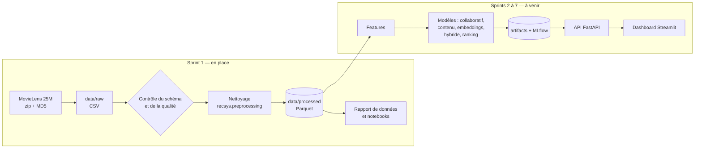

# Recommender System — Intelligent Movie Recommendation Platform

Système de recommandation de films pour une plateforme de streaming fictive, construit sur
MovieLens 25M : filtrage collaboratif, filtrage par contenu, embeddings, modèle hybride et
*learning to rank*, exposés par une API et un dashboard.

> **État d'avancement : Sprint 1 terminé (données).** Les sections marquées *à venir* décrivent
> ce qui est prévu, pas ce qui existe. Aucun résultat de modèle n'est encore publié ici, parce
> qu'aucun modèle n'a encore été entraîné.

| Sprint | Contenu | État |
|---|---|---|
| 1 | Initialisation, téléchargement vérifié, exploration, nettoyage, rapport | ✅ fait |
| 2 | Filtrage collaboratif (user-based, item-based, factorisation) | à venir |
| 3 | Filtrage par contenu (TF-IDF) et embeddings | à venir |
| 4 | Système hybride, cold start, diversité | à venir |
| 5 | Learning to rank (XGBoost) | à venir |
| 6 | API FastAPI et dashboard Streamlit | à venir |
| 7 | MLflow, Docker, CI, documentation finale | à venir |

## Problématique

Une plateforme de streaming propose des dizaines de milliers de titres ; un utilisateur n'en
verra qu'une infime partie. Il faut donc choisir, pour chacun, la poignée de films à mettre en
avant — à partir de son historique, des goûts d'utilisateurs proches et du contenu des films —
sans se contenter de recommander les mêmes succès à tout le monde.

## Architecture



Toute la logique vit dans le paquet installable `src/recsys`. Les notebooks, les scripts, et
plus tard l'API et le dashboard, ne font que l'appeler : un calcul n'existe qu'à un seul
endroit, et cet endroit est testé.

```
recommender-system/
├── configs/config.yaml        configuration centrale (dataset, chemins, seuils, graine)
├── data/                      raw / processed / features — jamais versionné
├── docs/DATASET.md            provenance et conditions d'utilisation
├── notebooks/                 01 exploration, 02 prétraitement (exécutés, sorties incluses)
├── reports/                   rapport de données généré + figures
├── scripts/                   points d'entrée en ligne de commande
├── src/recsys/
│   ├── config.py              chargement et validation Pydantic de la configuration
│   ├── data/                  téléchargement vérifié, schémas, chargement, contrôles qualité
│   ├── preprocessing/         nettoyage (fonctions pures) et pipeline
│   ├── analysis/              statistiques, graphiques, génération du rapport
│   ├── utils/                 journalisation, graines aléatoires
│   └── features/ models/ evaluation/     vides pour l'instant (sprints 2 à 5)
└── tests/                     37 tests Pytest
```

## Technologies

Seules les bibliothèques réellement utilisées par le code existant sont installées ; les autres
arriveront avec le sprint qui en a besoin.

| Outil | Rôle au Sprint 1 |
|---|---|
| Python 3.11 | Version cible |
| Pandas 3, NumPy 2 | Chargement, nettoyage, statistiques |
| PyArrow / Parquet | Stockage intermédiaire typé et compact |
| Pydantic, PyYAML | Configuration validée |
| Matplotlib | Figures du rapport et des notebooks |
| Pytest, Ruff | Tests et qualité du code |
| Jupyter | Notebooks d'exploration |

## Dataset

MovieLens 25M (GroupLens). Provenance, licence et justification du choix : [docs/DATASET.md](docs/DATASET.md).
Rapport chiffré complet, généré à partir des données : [reports/data_report.md](reports/data_report.md).

### Ce que les données contiennent

| | |
|---|---|
| Notes | 25 000 095 |
| Utilisateurs | 162 541 |
| Films au catalogue | 62 423, dont 59 047 notés au moins une fois |
| Densité de la matrice utilisateur × film | 0,26 % |
| Note moyenne / médiane | 3,53 / 3,5 |
| Période | 9 janvier 1995 – 21 novembre 2019 |
| Tags | 1 093 360 applications, sur 72,5 % du catalogue |

### Qualité

Les données brutes sont propres : aucune valeur manquante dans les notes, aucun doublon
(utilisateur, film), aucune note hors de l'échelle 0,5–5, aucune référence à un film absent
du catalogue. Les seuls défauts relevés :

- 16 tags manquants (27 lignes de tags retirées après normalisation et dédoublonnage) ;
- 107 films sans identifiant TMDB ;
- 5 062 films sans genre et 412 titres sans année — laissés vides, rien n'est inventé ;
- 98 titres portés par plusieurs `movieId` — conservés tels quels, faute de preuve qu'il s'agit
  du même film.

### Constats qui orientent la modélisation


1. **Longue traîne très marquée.** La moitié des films notés ont 6 notes ou moins, et 1 % des
   films concentrent 47,6 % des notes. Un modèle naïf recommandera surtout des succès : il
   faudra mesurer la couverture du catalogue, pas seulement la précision.
2. **Notes biaisées vers le haut.** 49,8 % des notes valent 4 ou plus, 12,8 % valent 2 ou moins.
   Le seuil qui définira une interaction « positive » devra être justifié (Sprint 2).
3. **Chaque utilisateur a son échelle.** La note moyenne par utilisateur va de 2,9 (5ᵉ centile)
   à 4,4 (95ᵉ centile) : les modèles collaboratifs devront centrer les notes.
4. **La plupart des utilisateurs notent en une seule session.** 60,4 % ont déposé toutes leurs
   notes en moins de 24 heures. Avec une coupure temporelle globale à 80 % des notes, seuls
   20,6 % des utilisateurs de test ont un historique d'entraînement. Le protocole
   d'évaluation devra en tenir compte : c'est la première décision du Sprint 2.
5. **Le contenu textuel est inégal.** 27,5 % des films n'ont aucun tag, et la médiane est de
   5 tags distincts par film tagué. L'approche par contenu devra s'appuyer aussi sur les genres
   et le titre.

### Nettoyage et jeu `interactions`

Le pipeline écrit cinq fichiers Parquet dans `data/processed/` : `ratings`, `movies` (année
extraite du titre, genres en liste), `tags` (texte normalisé), `links`, et `interactions`.

`interactions` est le jeu destiné aux modèles collaboratifs. Il ne garde que les utilisateurs
et les films ayant au moins 20 notes, par filtrage itératif. Effet mesuré de ce seuil :

| Minimum de notes par film | Notes conservées | Films conservés | Densité |
|---|---|---|---|
| 1 (aucun filtre) | 100,00 % | 59 047 | 0,260 % |
| 5 | 99,78 % | 32 711 | 0,469 % |
| 10 | 99,56 % | 24 324 | 0,630 % |
| **20 (retenu)** | **99,23 %** | **18 424** | **0,829 %** |
| 50 | 98,56 % | 13 172 | 1,153 % |
| 100 | 97,74 % | 10 322 | 1,461 %  |

Le seuil de 20 écarte 69 % des films notés pour moins de 1 % des notes : ces films n'apportent
presque aucun signal collaboratif. Ils restent dans `movies.parquet` et relèveront des approches
par contenu (cold start film). Le seuil se règle dans `configs/config.yaml`.

## Installation

Prérequis : Python 3.11, environ 2 Go d'espace disque pour les données.

```bash
python -m venv .venv
```

```bash
.venv\Scripts\activate          # Windows ; sous Linux/macOS : source .venv/bin/activate
```

```bash
pip install -r requirements-dev.txt
```

```bash
pip install --no-deps -e .
```

## Utilisation

```bash
python scripts/download_data.py
```

Télécharge l'archive (262 Mo), vérifie sa somme MD5, l'extrait et contrôle les colonnes des CSV.

```bash
python scripts/prepare_data.py
```

Contrôle qualité puis nettoyage vers `data/processed/` (environ 1 minute, pic mémoire de
quelques Go).

```bash
python scripts/build_data_report.py
```

Régénère `reports/data_report.md` et ses figures.

```bash
jupyter lab notebooks
```

Avec `make` (Linux, macOS, CI) : `make install`, `make all`, `make test`, `make lint`.

## Tests

```bash
python -m pytest
```

```bash
python -m ruff check .
```

Les 37 tests tournent en quelques secondes sur des jeux miniatures au format MovieLens, sans
avoir besoin du dataset réel. Ils couvrent : la validation de la configuration, le
téléchargement (somme de contrôle, archive corrompue, refus d'une archive qui écrirait hors
du dossier cible), la détection d'un schéma inattendu, les contrôles qualité, chaque règle de
nettoyage, le filtrage itératif, les statistiques, et le pipeline de bout en bout jusqu'au
rapport.

## Reproductibilité

- Versions figées dans `requirements.txt` (exécution) et `requirements-dev.txt` (environnement
  complet), produites par `pip freeze` après installation et exécution réelles.
- Archive vérifiée par somme MD5 avant extraction.
- Graine aléatoire unique dans `configs/config.yaml`, appliquée par `recsys.utils.seed.set_seed`.
- Le rapport et les notebooks sont régénérables par une commande.

## Limites actuelles

- Aucun modèle, aucune API, aucun dashboard à ce stade.
- MovieLens ne fournit ni description de film ni données de visionnage : les « habitudes de
  visionnage » se limiteront aux notes et à leur horodatage.
- Les notes s'arrêtent en 2019 et proviennent d'utilisateurs ayant noté au moins 20 films :
  le dataset ne contient pas de vrais utilisateurs débutants, il faudra les simuler pour
  évaluer le cold start.
- Les fichiers *tag genome* de l'archive ne sont pas encore exploités.
- La CI GitHub Actions et Docker sont prévus au Sprint 7.

## Données et licence

Les données MovieLens ne sont pas redistribuées dans ce dépôt (voir [docs/DATASET.md](docs/DATASET.md)).

> F. Maxwell Harper and Joseph A. Konstan. 2015. The MovieLens Datasets: History and Context.
> ACM Transactions on Interactive Intelligent Systems (TiiS) 5, 4: 19:1–19:19.
