# Recommender System — Intelligent Movie Recommendation Platform

Système de recommandation de films pour une plateforme de streaming fictive, construit sur
MovieLens 25M : filtrage collaboratif, filtrage par contenu, embeddings, modèle hybride et
*learning to rank*, exposés par une API et un dashboard.

[](https://github.com/Daoudbamba/recommender-system/actions/workflows/ci.yml)

> Tous les scores publiés ici sortent des fichiers `reports/*_results.json`, écrits par les
> expériences réellement exécutées. Aucun chiffre n'est saisi à la main.

## En bref

- **25 millions de notes** (MovieLens 25M), nettoyées et analysées.
- **14 modèles comparés** sur le même protocole, sans fuite de données : séparation
  temporelle, réglage sur une période de validation, mesure unique sur le futur.
- **Meilleur modèle** : un ranking XGBoost qui réordonne les candidats d'un système hybride.
  NDCG@10 de 0,208, soit 2,6 fois la popularité et 36 % de mieux que l'hybride.
- **Cas réels traités** : nouvel utilisateur, film sans notes, diversité des listes, biais de
  popularité, explication de chaque recommandation.
- **Industrialisé** : API FastAPI, dashboard Streamlit, suivi MLflow, Docker Compose,
  212 tests et intégration continue GitHub Actions.

| Modèle | NDCG@10 | Recall@10 | Couverture@10 |
|---|---|---|---|
| Popularité (référence) | 0,079 | 0,032 | 1,9 % |
| Item-kNN (collaboratif) | 0,103 | 0,041 | 24,4 % |
| Contenu TF-IDF | 0,111 | 0,053 | 20,9 % |
| ALS implicite (collaboratif) | 0,138 | 0,060 | 12,6 % |
| Hybride (agrégation de rangs) | 0,153 | 0,067 | 15,8 % |
| **Ranking XGBoost** | **0,208** | **0,101** | 12,0 % |

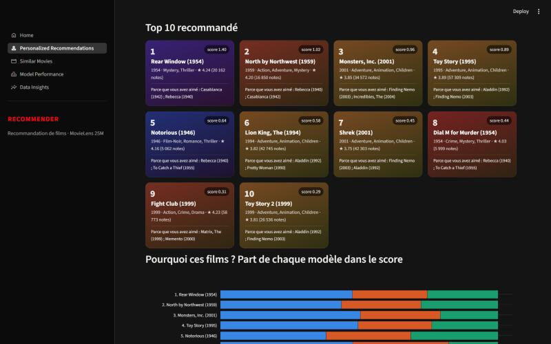

## Objectifs

1. Recommander à chaque utilisateur des films qu'il aimera, à partir de ses notes, des goûts
   d'utilisateurs proches et du contenu des films.
2. Comparer objectivement plusieurs familles d'approches, avec des métriques de classement et
   de prédiction de note, sur un protocole qui imite la production.
3. Traiter les situations difficiles d'une vraie plateforme : cold start, diversité, popularité,
   identifiants inconnus.
4. Livrer un système utilisable et reproductible : API, interface, suivi des expériences,
   conteneurs, tests automatisés.

## Avancement

| Sprint | Contenu | État |
|---|---|---|
| 1 | Initialisation, téléchargement vérifié, exploration, nettoyage, rapport | ✅ fait |
| 2 | Filtrage collaboratif (user-based, item-based, factorisation), protocole d'évaluation | ✅ fait |
| 3 | Filtrage par contenu (TF-IDF), embeddings, moteur de films similaires | ✅ fait |
| 4 | Système hybride, cold start, diversité | ✅ fait |
| 5 | Learning to rank (XGBoost) | ✅ fait |
| 6 | API FastAPI et dashboard Streamlit | ✅ fait |
| 7 | MLflow, Docker, CI, documentation finale | ✅ fait |

## Problématique

Une plateforme de streaming propose des dizaines de milliers de titres ; un utilisateur n'en
verra qu'une infime partie. Il faut donc choisir, pour chacun, la poignée de films à mettre en
avant — à partir de son historique, des goûts d'utilisateurs proches et du contenu des films —
sans se contenter de recommander les mêmes succès à tout le monde.

## Architecture

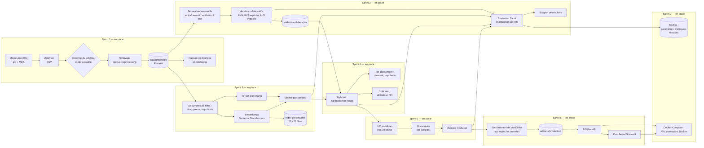

Toute la logique vit dans le paquet installable `src/recsys`. Les notebooks, les scripts et
l'API ne font que l'appeler, et le dashboard ne parle qu'à l'API : un calcul n'existe qu'à un seul
endroit, et cet endroit est testé.

```
recommender-system/
├── .github/workflows/ci.yml   intégration continue : lint, tests, image Docker
├── api/                       API FastAPI : routes, schémas Pydantic, service métier
├── configs/config.yaml        configuration centrale (dataset, chemins, seuils, graine)
├── dashboard/                 dashboard Streamlit : 5 pages, client HTTP de l'API, thème
├── data/                      raw / processed / features — jamais versionné
├── docs/                      provenance du dataset, démonstration, captures
├── Dockerfile, docker-compose.yml   image de service et stack locale
├── notebooks/                 01 à 08 : exploration, prétraitement, features, collaboratif, contenu, embeddings, hybride, ranking
├── reports/                   rapports générés (données, modèles) + figures + résultats JSON
├── scripts/                   points d'entrée en ligne de commande
├── src/recsys/
│   ├── config.py              chargement et validation Pydantic de la configuration
│   ├── data/                  téléchargement vérifié, schémas, chargement, contrôles qualité
│   ├── preprocessing/         nettoyage (fonctions pures) et pipeline
│   ├── analysis/              statistiques, graphiques, génération des rapports
│   ├── evaluation/            séparation temporelle, métriques, protocole
│   ├── features/              documents de films, TF-IDF, embeddings avec cache, variables de ranking
│   ├── models/                contrat commun, collaboratif, contenu, hybride, cold start, ranking
│   ├── experiments/           entraînement, sélection sur validation, mesure sur test
│   ├── serving/               entraînement de production, chargement unique des modèles
│   ├── tracking.py            suivi des expériences dans MLflow
│   └── utils/                 journalisation, graines aléatoires
└── tests/                     212 tests Pytest
```

## Technologies

Chaque outil a été ajouté par le sprint qui en avait besoin, et seulement s'il servait.

| Outil | Rôle |
|---|---|
| Python 3.11 | Version cible |
| Pandas 3, NumPy 2 | Chargement, nettoyage, statistiques |
| PyArrow / Parquet | Stockage intermédiaire typé et compact |
| Pydantic, PyYAML | Configuration validée |
| SciPy (matrices creuses) | Matrice utilisateur × film, similarités, kNN |
| implicit | ALS pour retours implicites |
| scikit-learn | TF-IDF et normalisation |
| Sentence Transformers (PyTorch CPU) | Embeddings des textes de films et des requêtes |
| XGBoost | Modèle de ranking (`XGBRanker`) |
| FastAPI, Pydantic, Uvicorn | API REST, validation des requêtes, documentation Swagger |
| Streamlit, Plotly | Dashboard interactif |
| httpx | Client HTTP du dashboard vers l'API |
| Matplotlib | Figures des rapports et des notebooks |
| MLflow | Suivi des expériences : paramètres, métriques, artefacts |
| Docker, Docker Compose | Image de service et lancement de la stack complète |
| GitHub Actions | Intégration continue |
| Pytest, Ruff | Tests et qualité du code |
| Jupyter | Notebooks d'exploration |

## Dataset

MovieLens 25M (GroupLens). Provenance, licence et justification du choix : [docs/DATASET.md](docs/DATASET.md).
Rapport chiffré complet, généré à partir des données : [reports/data_report.md](reports/data_report.md).

### Ce que les données contiennent

| | |
|---|---|
| Notes | 25 000 095 |
| Utilisateurs | 162 541 |
| Films au catalogue | 62 423, dont 59 047 notés au moins une fois |
| Densité de la matrice utilisateur × film | 0,26 % |
| Note moyenne / médiane | 3,53 / 3,5 |
| Période | 9 janvier 1995 – 21 novembre 2019 |
| Tags | 1 093 360 applications, sur 72,5 % du catalogue |

### Qualité

Les données brutes sont propres : aucune valeur manquante dans les notes, aucun doublon
(utilisateur, film), aucune note hors de l'échelle 0,5–5, aucune référence à un film absent
du catalogue. Les seuls défauts relevés :

- 16 tags manquants (27 lignes de tags retirées après normalisation et dédoublonnage) ;
- 107 films sans identifiant TMDB ;
- 5 062 films sans genre et 412 titres sans année — laissés vides, rien n'est inventé ;
- 98 titres portés par plusieurs `movieId` — conservés tels quels, faute de preuve qu'il s'agit
  du même film.

### Constats qui orientent la modélisation

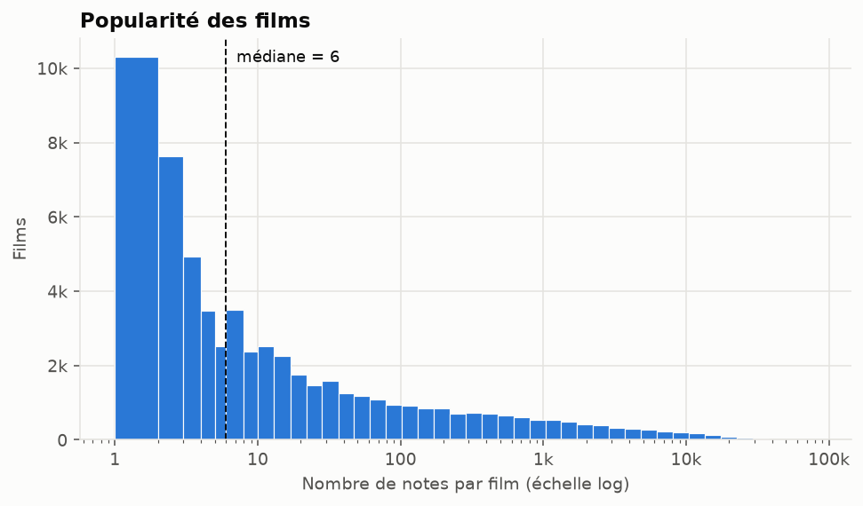

1. **Longue traîne très marquée.** La moitié des films notés ont 6 notes ou moins, et 1 % des
   films concentrent 47,6 % des notes. Un modèle naïf recommandera surtout des succès : il
   faudra mesurer la couverture du catalogue, pas seulement la précision.
2. **Notes biaisées vers le haut.** 49,8 % des notes valent 4 ou plus, 12,8 % valent 2 ou moins.
   Le seuil qui définira une interaction « positive » devra être justifié (Sprint 2).
3. **Chaque utilisateur a son échelle.** La note moyenne par utilisateur va de 2,9 (5ᵉ centile)
   à 4,4 (95ᵉ centile) : les modèles collaboratifs devront centrer les notes.
4. **La plupart des utilisateurs notent en une seule session.** 60,4 % ont déposé toutes leurs
   notes en moins de 24 heures. Avec une coupure temporelle globale à 80 % des notes, seuls
   20,6 % des utilisateurs de test ont un historique d'entraînement. Le protocole
   d'évaluation devra en tenir compte : c'est la première décision du Sprint 2.
5. **Le contenu textuel est inégal.** 27,5 % des films n'ont aucun tag, et la médiane est de
   5 tags distincts par film tagué. L'approche par contenu devra s'appuyer aussi sur les genres
   et le titre.

### Nettoyage et jeu `interactions`

Le pipeline écrit cinq fichiers Parquet dans `data/processed/` : `ratings`, `movies` (année
extraite du titre, genres en liste), `tags` (texte normalisé), `links`, et `interactions`.

`interactions` est le jeu destiné aux modèles collaboratifs. Il ne garde que les utilisateurs
et les films ayant au moins 20 notes, par filtrage itératif. Effet mesuré de ce seuil :

| Minimum de notes par film | Notes conservées | Films conservés | Densité |
|---|---|---|---|
| 1 (aucun filtre) | 100,00 % | 59 047 | 0,260 % |
| 5 | 99,78 % | 32 711 | 0,469 % |
| 10 | 99,56 % | 24 324 | 0,630 % |
| **20 (retenu)** | **99,23 %** | **18 424** | **0,829 %** |
| 50 | 98,56 % | 13 172 | 1,153 % |
| 100 | 97,74 % | 10 322 | 1,461 %  |

Le seuil de 20 écarte 69 % des films notés pour moins de 1 % des notes : ces films n'apportent
presque aucun signal collaboratif. Ils restent dans `movies.parquet` et relèveront des approches
par contenu (cold start film). Le seuil se règle dans `configs/config.yaml`.

## Filtrage collaboratif (Sprint 2)

Rapport complet généré : [reports/collaborative_report.md](reports/collaborative_report.md).
Démonstration commentée : [notebooks/04_collaborative_filtering.ipynb](notebooks/04_collaborative_filtering.ipynb).

### Méthodologie d'évaluation

Le protocole imite la production : on apprend sur le passé, on recommande pour le futur.

| Jeu | Notes d'entraînement | Période évaluée | Utilisateurs évalués |
|---|---|---|---|
| Validation (choix des hyperparamètres) | 19,9 M, jusqu'au 25 juin 2016 | jusqu'au 4 janvier 2018 | 5 006 |
| Test (mesure finale) | 22,4 M, jusqu'au 4 janvier 2018 | jusqu'au 21 novembre 2019 | 6 206 |

- **Aucune fuite** : rien de postérieur à la coupure n'entre dans l'entraînement, y compris pour
  décider quels films ont assez de notes. Le test ne sert jamais à choisir un hyperparamètre.
- **Film pertinent** : note ≥ 4. Une absence de note n'est jamais traitée comme un avis négatif
  à l'entraînement.
- **Candidats** : tous les films du catalogue d'entraînement que l'utilisateur n'a pas encore notés
  (16 007 films), sans échantillonnage de négatifs.
- **Métriques** : Precision, Recall, F1, MAP et NDCG à 5, 10 et 20 ; couverture du catalogue ;
  RMSE et MAE pour les modèles qui prédisent une note.

Deux limites à garder en tête en lisant les scores :

- un film recommandé que l'utilisateur n'a jamais noté compte comme une erreur, même s'il lui
  aurait plu. Les valeurs absolues sont donc des bornes basses ; ce sont les écarts entre modèles
  qui s'interprètent ;
- les utilisateurs évalués sont ceux qui reviennent après la coupure, donc de gros utilisateurs
  (historique médian de 275 notes). Les 11 950 utilisateurs apparus pendant la période de test
  n'ont aucun historique : ils relèvent du cold start (Sprint 4).

### Modèles

| Modèle | Principe | Sortie |
|---|---|---|
| Popularité | Films ayant reçu le plus de notes ≥ 4 | classement |
| Biais | Moyenne globale + biais utilisateur + biais film, amortis | note et classement |
| Item-kNN | Similarité cosinus entre films sur les résidus du modèle de biais, 50 voisins | note et classement |
| User-kNN | Même principe entre utilisateurs, 200 voisins cherchés à la demande | note et classement |
| ALS explicite | Factorisation des résidus sur les notes observées (implémentation NumPy du projet) | note et classement |
| ALS implicite | Factorisation du signal binaire « a aimé » (bibliothèque `implicit`) | classement |

### Résultats sur le test

| Modèle | Precision@10 | Recall@10 | MAP@10 | NDCG@10 | Couverture@10 | RMSE | MAE |
|---|---|---|---|---|---|---|---|
| Popularité | 0,0654 | 0,0319 | 0,0406 | 0,0786 | 1,9 % | — | — |
| Biais | 0,0463 | 0,0278 | 0,0264 | 0,0559 | 0,6 % | 0,8710 | 0,6461 |
| Item-kNN | 0,0881 | 0,0414 | 0,0551 | 0,1029 | **24,4 %** | 0,8681 | 0,6324 |
| User-kNN | 0,0816 | 0,0363 | 0,0510 | 0,0953 | 11,6 % | 0,8976 | 0,6633 |
| ALS explicite | 0,0322 | 0,0221 | 0,0170 | 0,0376 | 17,1 % | **0,8263** | **0,6040** |
| ALS implicite | **0,1202** | **0,0597** | **0,0747** | **0,1381** | 12,6 % | — | — |

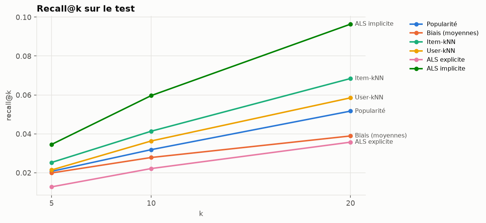

### Ce qu'il faut en retenir

1. **L'ALS implicite est le meilleur pour recommander** : NDCG@10 de 0,138 contre 0,079 pour la
   popularité, soit 76 % de mieux. En moyenne, 12 % de ses dix recommandations sont des films
   que l'utilisateur a réellement aimés ensuite.
2. **Bien prédire une note n'est pas bien recommander.** L'ALS explicite a la meilleure RMSE
   (0,826) mais le plus mauvais classement, sous la popularité. Il apprend à estimer la note des
   films qu'un utilisateur choisit de noter, pas à deviner lesquels il choisira. C'est la raison
   pour laquelle le projet évalue les deux familles de métriques séparément.
3. **L'item-kNN offre le meilleur compromis pertinence / diversité** : 31 % de mieux que la
   popularité en NDCG@10, tout en recommandant 24 % du catalogue contre 2 %. Il est en plus
   explicable (« parce que vous avez aimé… ») et se sert en 1,7 ms par utilisateur.
4. **Le user-kNN est le plus coûteux à servir** : 45 ms par utilisateur, 26 fois plus que
   l'item-kNN, pour un résultat inférieur. Sa RMSE (0,898) est même moins bonne que celle du
   simple modèle de biais (0,871) : en l'état, il n'apporte rien à la prédiction de note.
5. **Les gros historiques sont les plus difficiles.** Le NDCG@10 de l'ALS implicite passe de 0,166
   pour les utilisateurs de 5 à 50 notes à 0,120 pour ceux de 401 à 1 000 notes.
6. **Biais de popularité mesuré.** Les films du top-10 de l'ALS implicite ont en moyenne 20 400
   notes d'entraînement, contre 12 100 pour l'item-kNN. La diversité sera traitée au Sprint 4.

### Limites de ce sprint

- Grilles d'hyperparamètres volontairement petites (2 ou 3 configurations par modèle) : le
  user-kNN prend 7 minutes par évaluation et l'ALS explicite 7 à 12 minutes par entraînement.
- Un seul découpage temporel et une seule graine : pas d'intervalle de confiance sur les écarts.
- Les modèles sauvegardés sont entraînés jusqu'au 4 janvier 2018 (la période de test est exclue).
  Un réentraînement sur toutes les données est prévu avant la mise en service (Sprint 6).
- Aucun modèle de ce sprint ne sait répondre à un utilisateur ou un film inconnu.

## Filtrage par contenu et embeddings (Sprint 3)

Rapport complet généré : [reports/content_report.md](reports/content_report.md).
Notebooks : [03 feature engineering](notebooks/03_feature_engineering.ipynb),
[05 TF-IDF](notebooks/05_content_based_filtering.ipynb),
[06 embeddings](notebooks/06_embeddings.ipynb).

### Feature engineering

MovieLens ne fournit aucune description de film, et le projet n'en invente pas. Le contenu d'un
film se limite à son titre, son année, ses genres et les tags libres posés par les utilisateurs.

- **Tags agrégés par utilisateurs distincts** : les 1 093 333 applications de tags deviennent
  463 458 couples (film, tag), pondérés par le nombre de personnes qui ont posé le tag.
- **Pas de fuite temporelle** : les tags sont horodatés, et seuls ceux posés avant la date de
  coupure sont utilisés. Pour le test, cela représente 52 % des couples (film, tag) du dataset.
- **Couverture** : 72 % du catalogue complet a au moins un tag, mais 91 % des 16 007 films
  évaluables en ont. Les films sans contenu sont surtout ceux que personne ne note.

Deux représentations sont construites à partir de ces mêmes informations :

| Représentation | Construction | Dimension |
|---|---|---|
| TF-IDF par champ | Trois blocs (genres, tags entiers, mots du titre), chacun avec son IDF, pondérés puis concaténés | 31 462 termes, 10 non nuls par film en moyenne |
| Embeddings | Phrase « titre (année). Genres : … Tags : … » avec les 15 tags les plus consensuels, encodée par `all-MiniLM-L6-v2` | 384, dense |

Le même modèle de recommandation sert pour les deux : chaque film candidat reçoit la somme de ses
similarités avec les films aimés par l'utilisateur (note ≥ 4) parmi ses 50 plus proches voisins
de contenu. Seule la représentation change, ce qui rend la comparaison équitable.

### Résultats sur le test

Même protocole, mêmes 6 206 utilisateurs et mêmes 16 007 films candidats qu'au Sprint 2.

| Modèle | Precision@10 | Recall@10 | MAP@10 | NDCG@10 | Couverture@10 |
|---|---|---|---|---|---|
| Popularité | 0,0654 | 0,0319 | 0,0406 | 0,0786 | 1,9 % |
| Item-kNN (collaboratif) | 0,0881 | 0,0414 | 0,0551 | 0,1029 | 24,4 % |
| ALS implicite (collaboratif) | **0,1202** | **0,0597** | **0,0747** | **0,1381** | 12,6 % |
| Contenu TF-IDF | 0,0890 | 0,0529 | 0,0572 | 0,1113 | 20,9 % |
| Contenu embeddings | 0,0523 | 0,0286 | 0,0272 | 0,0610 | **24,6 %** |

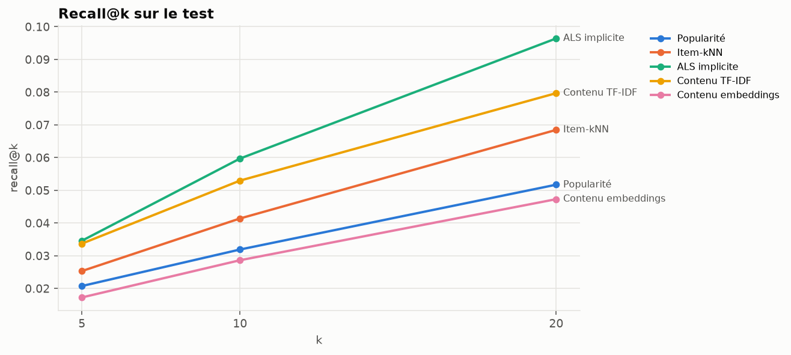

### Ce qu'il faut en retenir

1. **Le TF-IDF sur les tags est un vrai bon modèle.** Sans utiliser une seule note des autres
   utilisateurs pour rapprocher les films, il atteint un NDCG@10 de 0,111 : 42 % de mieux que la
   popularité et au-dessus de l'item-kNN collaboratif (0,103). Il reste derrière l'ALS implicite.
2. **Les embeddings génériques déçoivent en recommandation.** Avec un NDCG@10 de 0,061, ils font
   moins bien que la simple popularité. Un modèle de langue généraliste, appliqué à une phrase
   courte, capte surtout le titre et le thème : il rapproche des films obscurs au titre voisin.
   Ses recommandations ont en moyenne 6 200 notes d'entraînement, contre 13 200 pour le TF-IDF.
3. **Ce sont les tags qui portent le signal.** Sur la validation, les genres seuls donnent un
   NDCG@10 de 0,017, les tags seuls 0,101, et la meilleure combinaison 0,103 (genres pondérés à
   0,2, titre à 0,3).
4. **La façon d'agréger l'historique compte autant que la représentation.** Moyenner les films
   aimés en un profil unique donne 0,003 en TF-IDF et 0,023 en embeddings sur la validation,
   contre 0,057 et 0,056 avec l'agrégation par voisins, à représentation identique.
5. **Le TF-IDF tient mieux sur les gros historiques.** Son NDCG@10 passe de 0,121 à 0,103 entre
   les plus petits et les plus gros historiques, quand l'item-kNN chute de 0,145 à 0,092.
6. **Les trois approches voient des choses différentes.** Seuls 6 % des dix voisins TF-IDF d'un
   film sont aussi ses voisins collaboratifs, et 10 % sont communs avec les embeddings. C'est
   l'argument en faveur du modèle hybride du Sprint 4.

### Moteur de films similaires et recherche sémantique

Les embeddings servent en revanche bien le moteur de films similaires, qui couvre les 62 423
films du catalogue, y compris les 46 000 que le filtrage collaboratif ne peut pas traiter faute
de notes. Pour *Matrix*, il renvoie les deux suites puis *Animatrix* ; le TF-IDF renvoie les
suites puis *Tron*, *Johnny Mnemonic* et *Dark City*, en citant les tags communs.

La recherche en texte libre fonctionne mais avec des limites constatées : elle privilégie les
films dont le titre contient les mots de la requête, et une requête en français renvoie des
titres non anglophones sans rapport, le modèle choisi étant surtout entraîné sur de l'anglais.

**FAISS n'est pas utilisé.** Une recherche exacte des dix plus proches voisins parmi 62 423
vecteurs de dimension 384 prend 11 ms en moyenne (12 ms au 95ᵉ centile) avec un simple produit
matriciel. Un index approché ajouterait une dépendance et une approximation sans gain
perceptible ; le choix serait à revoir au-delà du million de vecteurs.

### Limites de ce sprint

- La comparaison porte sur un seul modèle d'embeddings, généraliste et non adapté au domaine,
  et sur un seul gabarit de texte. Elle ne dit rien d'un modèle affiné sur des données de films.
- L'évaluation n'utilise que la moitié des tags du dataset, les autres étant postérieurs à la
  coupure : en service, avec tous les tags, le contenu serait mieux décrit qu'ici.
- La qualité des « films similaires » n'a pas de vérité terrain : elle est jugée sur des exemples
  et sur deux mesures indirectes (accord avec le collaboratif, cohérence de genres).
- Un film sans tag ni genre (0,07 % des films évaluables, 4,7 % du catalogue) n'a que son titre.

## Système hybride, diversité et cold start (Sprint 4)

Rapport complet généré : [reports/hybrid_report.md](reports/hybrid_report.md).
Démonstration commentée : [notebooks/07_hybrid_recommendation.ipynb](notebooks/07_hybrid_recommendation.ipynb).

### Combiner les modèles

Les composants sont la meilleure configuration de chaque modèle des sprints 2 et 3. Leurs scores
ne sont pas comparables (somme de similarités, produit de facteurs latents…) : trois stratégies
les ramènent sur une échelle commune avant la somme pondérée.

| Stratégie | Normalisation par utilisateur | NDCG@10 (validation) | NDCG@10 (test) |
|---|---|---|---|
| Pondérée | min-max, scores dans [0, 1] | 0,1696 | 0,1506 |
| Scores centrés-réduits | moyenne 0, écart-type 1 | 0,1669 | 0,1479 |
| **Agrégation de rangs (RRF)** | 1 / (60 + rang), les scores sont ignorés | **0,1699** | **0,1527** |

Chaque stratégie a été essayée avec sept combinaisons de poids. La combinaison retenue, sur la
validation, est la même pour les trois : **ALS implicite 0,50, item-kNN 0,25, TF-IDF 0,25**.
Justification mesurée : l'ALS implicite est le meilleur modèle seul et reçoit le plus gros
poids ; le TF-IDF apporte un signal indépendant des notes ; l'item-kNN élargit la couverture.
Ajouter les embeddings n'améliore aucune stratégie (0,164 contre 0,170 en RRF).

### Résultats sur le test

| Modèle | Precision@10 | Recall@10 | MAP@10 | NDCG@10 | Couverture@10 |
|---|---|---|---|---|---|
| Popularité | 0,0654 | 0,0319 | 0,0406 | 0,0786 | 1,9 % |
| Item-kNN | 0,0881 | 0,0414 | 0,0551 | 0,1029 | 24,4 % |
| Contenu TF-IDF | 0,0890 | 0,0529 | 0,0572 | 0,1113 | 20,9 % |
| ALS implicite | 0,1202 | 0,0597 | 0,0747 | 0,1381 | 12,6 % |
| **Hybride RRF** | **0,1313** | **0,0674** | **0,0855** | **0,1527** | 15,8 % |

L'hybride dépasse le meilleur modèle seul de 11 % en NDCG@10 et de 13 % en rappel, tout en
recommandant une part plus large du catalogue (15,8 % contre 12,6 %). Il double presque la
popularité (+94 %).

### Diversité et biais de popularité

Le re-classement part des 50 meilleurs candidats de l'hybride. Deux leviers, mesurés sur le test
sans qu'aucun réglage n'y soit sélectionné :

| Réglage | NDCG@10 | Diversité intra-liste | Couverture@10 | Popularité moyenne du top-10 |
|---|---|---|---|---|
| Hybride seul | 0,1527 | 0,548 | 15,8 % | 19 277 notes |
| MMR, λ = 0,7 | 0,1522 | 0,559 | 16,0 % | 19 325 |
| MMR, λ = 0,5 | 0,1510 | 0,572 | 16,3 % | 19 242 |
| MMR, λ = 0,3 | 0,1457 | 0,602 | 16,9 % | 18 793 |
| Pénalité de popularité 0,2 | 0,1543 | 0,548 | 16,7 % | 18 901 |
| Pénalité de popularité 0,4 | 0,1558 | 0,547 | 17,8 % | 18 395 |

- **MMR** (Maximal Marginal Relevance) pénalise la ressemblance avec les films déjà placés,
  mesurée dans l'espace des embeddings. Jusqu'à λ = 0,5, la diversité monte pour une perte de
  pertinence de 1 % ; en dessous, la pertinence décroche. L'effet reste modeste : l'hybride
  produit déjà des listes variées.
- **La pénalité de popularité** fait mieux que prévu : elle élargit la couverture *et* améliore
  légèrement la pertinence (0,1558 contre 0,1527). Résultat à confirmer, puisqu'il est observé
  sur le test et non choisi sur la validation.

### Cold start utilisateur

Les 11 950 utilisateurs apparus après la coupure n'existent pas pour les modèles. On rejoue
l'arrivée de 2 000 d'entre eux en révélant leurs premières notes dans l'ordre chronologique.
Aucun réentraînement : chaque modèle calcule un score à partir des notes fournies à la volée
(pour l'ALS, résolution du vecteur latent de l'utilisateur à films fixés). La cible est la même
dans toutes les colonnes : les films aimés après les dix premières notes. NDCG@10 :

| Modèle | 0 note | 1 note | 3 notes | 5 notes | 10 notes |
|---|---|---|---|---|---|
| Popularité | **0,238** | 0,238 | 0,238 | 0,238 | 0,238 |
| Contenu TF-IDF | 0,040 | 0,156 | 0,194 | 0,218 | 0,254 |
| ALS implicite | 0,040 | 0,217 | 0,261 | 0,286 | 0,326 |
| Item-kNN | 0,040 | 0,201 | 0,261 | 0,293 | 0,334 |
| Hybride RRF | 0,048 | 0,232 | 0,285 | **0,320** | 0,369 |
| **Stratégie cold start** | **0,238** | **0,248** | **0,288** | 0,319 | **0,370** |

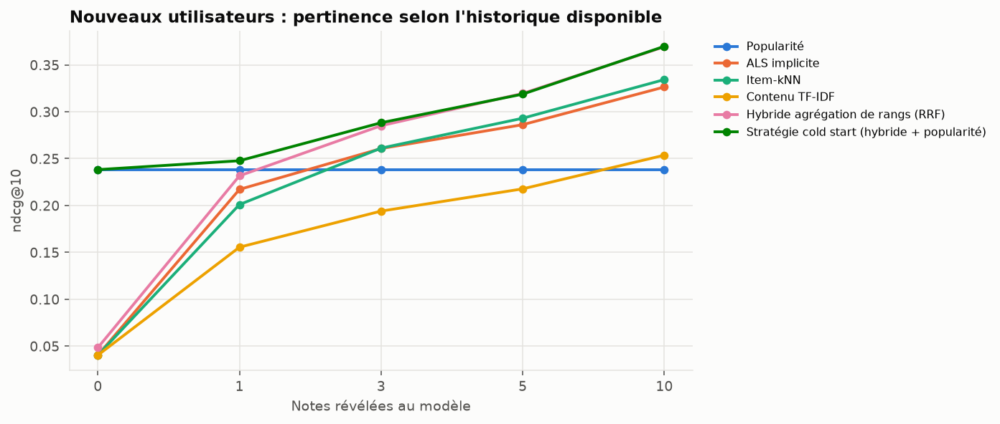

La **stratégie cold start** mélange l'hybride et la popularité, avec un poids de popularité de
`prior / (prior + nombre de notes)` : popularité pure sans historique, puis personnalisation
croissante. Elle égale ou dépasse le meilleur modèle à chaque étape.

- **Une seule note ne suffit pas** : avec une note, aucun modèle personnalisé ne bat la
  popularité. Il en faut trois pour que la personnalisation paie nettement (+21 %).
- **Dix notes changent tout** : la stratégie atteint 0,370, soit 55 % de mieux que la popularité.
- **Deux réglages corrigés en cours de sprint.** La première version mélangeait des scores
  bruts et utilisait un prior fixé a priori à 3 : elle restait sous l'hybride dès trois notes et
  recommandait surtout des succès généralistes. Le mélange se fait maintenant sur les rangs, et
  le prior (0,5) est choisi sur les nouveaux venus de la validation.

### Cold start film

Un film sans notes suffisantes ne peut pas être recommandé par un modèle collaboratif. Parmi les
26 470 films absents du catalogue d'entraînement (moins de 20 notes avant la coupure, films
sortis ensuite compris), le contenu seul retrouve une partie de ceux que 3 837 utilisateurs ont
aimés :

| Modèle | Recall@10 | NDCG@10 |
|---|---|---|
| Hasard | 0,0003 | 0,0005 |
| Contenu embeddings | 0,0213 | 0,0244 |
| Contenu TF-IDF | 0,0312 | 0,0378 |

Le TF-IDF fait cent fois mieux que le hasard, mais le niveau absolu reste faible : un film tout
juste ajouté n'a pas encore de tags, et son contenu se réduit à son titre et à ses genres.

### Limites de ce sprint

- Les poids de l'hybride sont choisis parmi sept combinaisons fixées à l'avance, pas optimisés
  en continu. Le Sprint 5 apprendra cette combinaison avec un modèle de ranking.
- L'écart entre les trois stratégies est faible (0,148 à 0,153) et mesuré sur un seul découpage :
  il ne permet pas d'affirmer que l'agrégation de rangs est intrinsèquement meilleure.
- Le niveau de diversité et la pénalité de popularité sont décrits, pas tranchés : c'est une
  décision produit que seule une expérience en ligne peut arbitrer.
- Le cold start est simulé sur des utilisateurs réels de 2018-2019 qui ont tous fini par noter
  au moins 20 films. De vrais visiteurs d'un soir se comporteraient autrement.
- Servir l'hybride demande quatre modèles en mémoire (environ 1,5 Go d'artefacts).

## Learning to rank avec XGBoost (Sprint 5)

Rapport complet généré : [reports/ranking_report.md](reports/ranking_report.md).
Démonstration commentée : [notebooks/08_ranking_model.ipynb](notebooks/08_ranking_model.ipynb).

### Architecture en deux étages

1. **Génération de candidats** : l'hybride du Sprint 4 propose 100 films par utilisateur.
2. **Ranking** : un `XGBRanker` les réordonne à partir de 19 variables, et apprend lui-même
   comment pondérer les modèles au lieu de s'en remettre à des poids fixés à la main.

### Prévention des fuites

| | Modèles de base entraînés jusqu'au | Labels pris entre |
|---|---|---|
| Entraînement du ranker | 25 juin 2016 | 25 juin 2016 et 4 janvier 2018 |
| Test du ranker | 4 janvier 2018 | 4 janvier 2018 et 21 novembre 2019 |

- Les variables d'une ligne ne regardent jamais au-delà du début de la période de ses labels :
  c'est ce dont on disposerait au moment de recommander.
- Les modèles de base qui produisent les scores n'ont pas vu les notes servant de labels. Sans
  cela, leurs scores seraient artificiellement bons à l'entraînement et le ranker apprendrait à
  leur faire trop confiance.
- Les hyperparamètres sont choisis sur 1 001 utilisateurs mis de côté parmi les 5 006 du jeu
  d'entraînement du ranker. Le test ne sert qu'à la mesure finale.
- `XGBRanker` exige des lignes groupées par requête : chaque utilisateur occupe 100 lignes
  consécutives, et l'entraînement refuse un jeu dont les groupes ne seraient pas triés.

### Variables

| Famille | Variables |
|---|---|
| Modèles | score centré-réduit et rang de chacun des quatre modèles, score de l'hybride |
| Film | popularité, note moyenne, part de notes positives, âge à la date de coupure |
| Utilisateur | taille de l'historique, note moyenne, part de films aimés |
| Croisées | affinité de genres, écart d'année et écart de popularité avec les films aimés |

Toutes sont calculées sur la seule période d'entraînement du fold. Une information manquante
(film sans année, utilisateur sans film aimé) reste manquante : XGBoost la gère nativement.

### Définition des labels

Parmi les 400 500 lignes d'entraînement, 89 % concernent un film que l'utilisateur n'a jamais
noté. Deux schémas ont été comparés pour ne pas traiter d'office cette absence comme un rejet :

| Schéma | Définition | NDCG@10 (jeu de réglage) |
|---|---|---|
| Gradué | 2 = aimé (note ≥ 4), 1 = non noté, 0 = noté sous 4 | 0,2265 |
| Binaire | 1 = aimé, 0 = tout le reste | **0,2281** |

Distinguer « inconnu » de « rejeté » n'a pas aidé : l'écart est dans le bruit, et le schéma
binaire, légèrement devant, a été retenu. Le résultat est rapporté tel quel. L'explication
probable est que les rejets explicites sont rares (4 % des lignes) et déjà mal classés par
l'hybride.

### Résultats sur le test

Même protocole, mêmes 6 206 utilisateurs et même catalogue que tous les modèles précédents.

| Modèle | Precision@10 | Recall@10 | MAP@10 | NDCG@10 | Couverture@10 |
|---|---|---|---|---|---|
| Popularité | 0,0654 | 0,0319 | 0,0406 | 0,0786 | 1,9 % |
| ALS implicite | 0,1202 | 0,0597 | 0,0747 | 0,1381 | 12,6 % |
| Hybride RRF | 0,1313 | 0,0674 | 0,0855 | 0,1527 | **15,8 %** |
| Ranking, scores des modèles seuls | 0,1261 | 0,0641 | 0,0784 | 0,1434 | 14,9 % |
| Ranking, sans variables de récence | 0,1493 | 0,0852 | 0,1007 | 0,1772 | 14,0 % |
| **Ranking XGBoost complet** | **0,1661** | **0,1014** | **0,1221** | **0,2079** | 12,0 % |

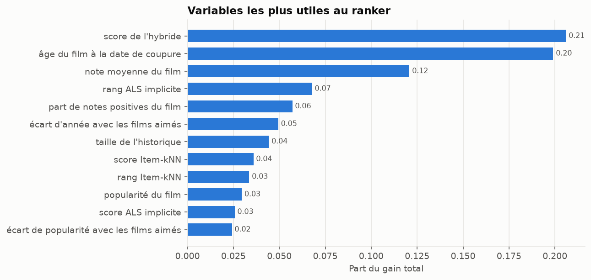

### Ce qu'il faut en retenir

1. **Le ranker est le meilleur modèle du projet** : NDCG@10 de 0,208, soit 36 % de mieux que
   l'hybride et 2,6 fois la popularité. Le rappel à 10 progresse de 50 %.
2. **Le gain ne vient pas d'une meilleure pondération des modèles.** Avec les seuls scores des
   modèles, le ranker fait moins bien que l'hybride (0,143 contre 0,153). Ce sont les variables
   que l'hybride ne voit pas qui font la différence.
3. **La récence explique environ la moitié du gain.** L'âge du film est la deuxième variable la
   plus utile (20 % du gain total). Sans les deux variables de récence, le ranker reste à 0,177,
   16 % au-dessus de l'hybride : après la coupure, les utilisateurs notent surtout des sorties
   récentes, ce qu'aucun modèle précédent ne pouvait savoir.
4. **Un saut de cette taille a d'abord été traité comme suspect.** La vérification de
   l'importance des variables a écarté une fuite et révélé une variable mal conçue : l'année
   absolue, dont le sens change quand la date de coupure avance. Remplacée par l'âge du film à
   la date de coupure, elle fait passer le NDCG@10 de 0,204 à 0,208.
5. **Les gros utilisateurs en profitent le plus** : le NDCG@10 passe de 0,151 à 0,241 pour les
   historiques de plus de 1 000 notes. Au total, 42 % des utilisateurs sont mieux servis que
   par l'hybride, 22 % moins bien, 36 % à égalité.
6. **Le prix à payer** : la couverture recule de 15,8 % à 12,0 %, et servir un utilisateur
   coûte 21 ms contre 4 ms pour l'hybride.

### Limites de ce sprint

- Le ranker ne peut que réordonner les candidats de l'hybride : 32 % seulement des films aimés
  figurent parmi les 100 candidats. C'est le plafond de son rappel, et la première piste
  d'amélioration (davantage de candidats, ou plusieurs générateurs).
- Le poids de la récence reflète la façon dont MovieLens est utilisé : il ne se transpose pas
  tel quel à une autre plateforme.
- Le ranker est entraîné sur 5 006 utilisateurs revenus après la coupure, donc de gros
  utilisateurs. Le cold start reste confié à la stratégie du Sprint 4.
- Un seul découpage temporel et une seule graine : pas d'intervalle de confiance, et l'écart
  entre les deux schémas de labels n'est pas significatif.
- La baisse de couverture n'a pas été corrigée : le re-classement par diversité du Sprint 4
  n'est pas encore appliqué en sortie du ranker.

## API et dashboard (Sprint 6)

### Des modèles évalués aux modèles servis

L'évaluation réserve les notes les plus récentes au test. Une fois les choix arrêtés,
`scripts/train_production.py` réentraîne tous les modèles sur **l'ensemble** des 25 M de notes
(162 541 utilisateurs, 18 430 films recommandables) et écrit un bundle dans
`artifacts/production/`. Rien n'y est re-réglé : hyperparamètres, poids de l'hybride et prior de
cold start sont repris de l'évaluation.

Une exception assumée : le modèle de ranking est servi tel qu'évalué au Sprint 5. Le réentraîner
sur des labels plus récents le rendrait sans doute meilleur, mais il ne resterait plus aucune
donnée pour le mesurer.

### API FastAPI

```bash
uvicorn api.main:app --port 8000
```

Documentation interactive (Swagger) : <http://localhost:8000/docs>. Les modèles sont chargés une
seule fois au démarrage (environ 1,5 Go en mémoire), jamais réentraînés par une requête.

| Route | Rôle |
|---|---|
| `GET /health` | État du service et présence de chaque artefact |
| `GET /movies` | Catalogue paginé, filtrable par titre et par genre |
| `GET /movies/{movie_id}` | Détail d'un film |
| `GET /recommendations/{user_id}` | Top-k personnalisé, avec explications ; `strategy` et `diversity` réglables |
| `POST /recommendations/cold-start` | Recommandations pour un visiteur à partir de quelques notes |
| `GET /similar-movies/{movie_id}` | Films proches, par embeddings, TF-IDF ou comportement |
| `POST /predict-rating` | Note estimée, avec la base de l'estimation |
| `GET /users/{user_id}/history` | Historique et genres préférés d'un utilisateur |
| `GET /stats`, `GET /metrics`, `GET /model-info` | Données du dashboard : statistiques, scores mesurés, modèles en service |

Exemple de réponse de `GET /recommendations/294?k=1`, mesurée sur l'API réelle :

```json
{
  "user_id": 294, "known_user": true, "strategy": "ranker", "n_ratings": 309,
  "items": [{
    "rank": 1,
    "movie": {"movie_id": 3949, "title": "Requiem for a Dream (2000)", "genres": ["Drama"]},
    "contributions": {"als_implicit": 0.507, "item_knn": 0.246, "tfidf": 0.246},
    "reasons": [
      "Recommandé surtout par les goûts d'utilisateurs proches",
      "Parce que vous avez aimé : Donnie Darko (2001) ; Eyes Wide Shut (1999)"
    ]
  }]
}
```

Comportements choisis pour les cas difficiles :

- **utilisateur inconnu** : `200` avec les films les plus appréciés et `known_user: false`,
  plutôt qu'une erreur, pour qu'un front puisse toujours afficher quelque chose ;
- **film inconnu** : `404` avec un message explicite ;
- **paramètre invalide** (k hors bornes, note qui n'est pas un multiple de 0,5, film noté deux
  fois…) : `422`, validé par Pydantic avant tout calcul ;
- **modèles absents** : l'API démarre quand même ; `/health` dit ce qui manque et les autres
  routes répondent `503` en indiquant la commande à lancer.

Temps de réponse mesurés sur la machine de développement, modèles chargés : 100 ms pour un
top-10 personnalisé avec le ranker (explications comprises), 25 ms pour des films similaires,
18 ms pour un utilisateur inconnu.

### Dashboard Streamlit

```bash
streamlit run dashboard/app.py
```

Le dashboard n'accède **qu'à l'API** (adresse réglable par la variable `RECSYS_API_URL`) : aucune
donnée n'est lue sur le disque ni simulée. Si l'API est arrêtée, chaque page l'indique et
rappelle la commande pour la lancer.

| Page | Contenu |
|---|---|
| Home | Chiffres clés, recherche de films, films populaires, recommandations d'un utilisateur |
| Personalized Recommendations | Historique, genres préférés, top 10 ou 20 avec raison et part de chaque modèle ; choix du modèle et du niveau de diversité ; onglet « nouveau visiteur » qui recommande à partir de quelques notes |
| Similar Movies | Trois moteurs de similarité, scores, comparaison des genres |
| Model Performance | Comparaison des 14 modèles mesurés, Precision, Recall, F1, MAP, NDCG et couverture à K = 5, 10, 20, RMSE et MAE |
| Data Insights | Volumes, répartition des notes, genres, activité des utilisateurs, films les plus notés |

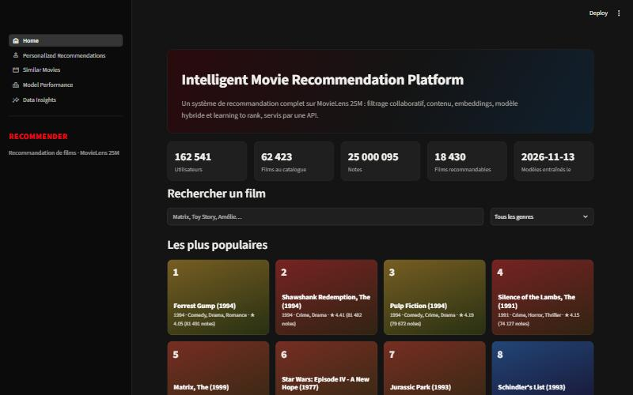


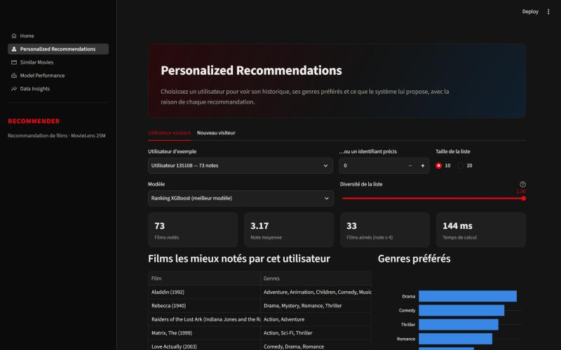

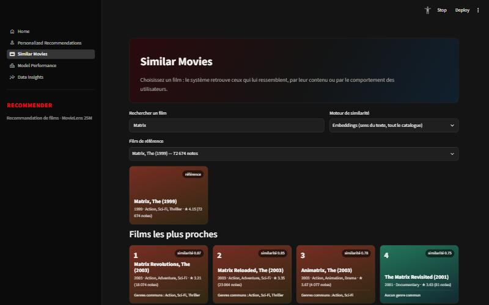

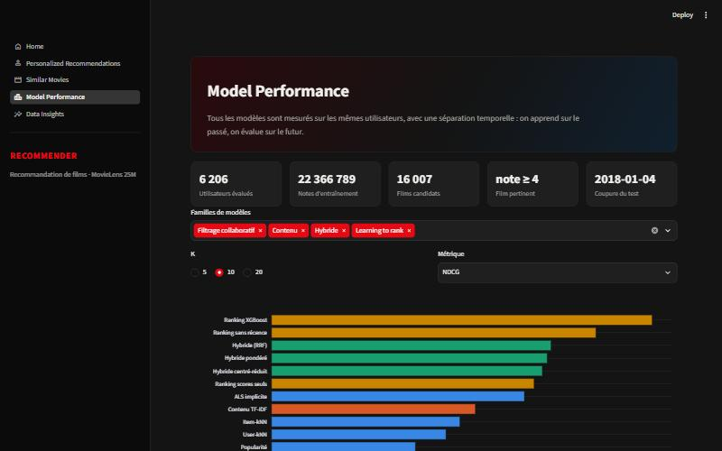

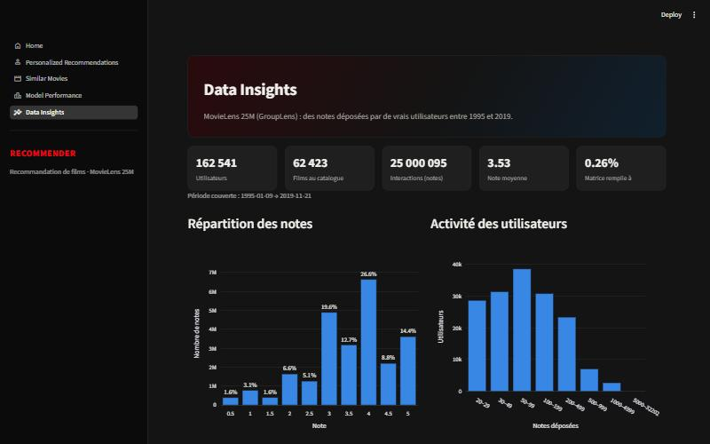

MovieLens ne fournit pas d'affiches : les films sont présentés par des cartes typographiques,
colorées selon leur genre principal.

### Limites de ce sprint

- Les captures ont été prises dans le navigateur intégré de l'environnement de développement,
  en résolution réduite.
- Les contributions affichées décrivent le score de l'hybride, qui génère les candidats ; le
  ranker les réordonne ensuite selon des critères (âge du film, note moyenne…) qui ne sont pas
  encore détaillés dans l'interface.
- Un seul processus sert les requêtes, avec un verrou autour des calculs : suffisant pour une
  démonstration, pas pour de la charge.
- Les modèles de production sont réentraînés à la main ; l'automatisation et le suivi des
  versions relèvent du Sprint 7 (MLflow).

## Suivi des expériences, Docker et CI (Sprint 7)

### MLflow

Chaque expérience est enregistrée dans MLflow : un run parent par lancement (graine, protocole,
fichier de résultats en artefact) et un run enfant par configuration évaluée (hyperparamètres,
toutes les métriques, jeu de validation ou de test, configuration retenue ou non).

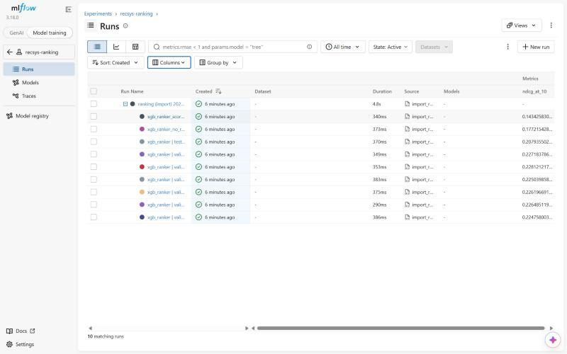

- **Stockage** : base SQLite `mlflow.db` et artefacts dans `mlruns/`, à la racine. MLflow 3
  n'accepte plus le stockage sur simples fichiers. La variable `MLFLOW_TRACKING_URI` redirige
  les runs, par exemple vers le serveur de la stack Docker (`http://localhost:5000`).
- **Historique** : les expériences des sprints 2 à 5 ont été exécutées avant l'ajout de MLflow.
  Plutôt que de les relancer (environ deux heures), `scripts/import_results_to_mlflow.py`
  rejoue leurs fichiers de résultats à l'identique ; ces runs portent le tag `source=import`.
  L'entraînement de production, lui, a été enregistré en direct.
- **Meilleur modèle** : `scripts/best_experiment.py` interroge MLflow et classe les modèles selon
  un critère explicite, par défaut le NDCG@10 sur le test des configurations retenues.

```bash
python scripts/best_experiment.py
```

```bash
mlflow ui --backend-store-uri sqlite:///mlflow.db
```

**Retrouver une expérience et son modèle** : dans l'interface, ouvrir l'expérience
(`recsys-collaborative`, `recsys-content`, `recsys-hybrid`, `recsys-ranking` ou
`recsys-production`), déplier le run parent, trier par `ndcg_at_10`. Le run retenu porte
`selected = true` ; ses paramètres permettent de le réentraîner à l'identique, et le run
`recsys-production` indique le dossier du bundle servi ainsi que son manifeste.

### Workflow de réentraînement

```bash
python scripts/retrain.py
```

Rejoue toute la chaîne dans l'ordre (téléchargement, nettoyage, quatre expériences, production,
rapports) avec la graine et la configuration de `configs/config.yaml`, chaque étape enregistrée
dans MLflow. `--from`, `--until` et `--only` sélectionnent des étapes, `--sample-users` fait un
essai rapide. L'étape de production a été rejouée ainsi en 5,6 minutes.

### Docker

```bash
docker compose up --build
```

| Service | Adresse | Rôle |
|---|---|---|
| `api` | <http://localhost:8000/docs> | modèles chargés depuis `artifacts/production`, monté en lecture seule |
| `dashboard` | <http://localhost:8501> | démarre quand l'API est prête (contrôle de santé) |
| `mlflow` | <http://localhost:5000> | serveur de suivi, base et artefacts dans un volume Docker |

- **Une seule image** pour l'API et le dashboard, avec les seules dépendances de service
  (`requirements-serving.txt` : ni PyTorch, ni MLflow, ni Jupyter). La construction échoue si
  un module du service ne s'importe pas.
- **Ni données ni modèles dans l'image** : la licence MovieLens interdit la redistribution ;
  le bundle est monté au lancement.
- **Mémoire** : l'API occupe 1,5 Go une fois les modèles chargés. Le serveur MLflow est lancé
  sans ses tâches de fond (évaluation de modèles génératifs), qui demandaient plus de 1,5 Go
  pour une fonction inutile ici.
- **PostgreSQL n'est pas utilisé** : rien dans le projet n'écrit de données en continu. Les
  données sont figées (Parquet), les modèles sont des fichiers, et SQLite suffit au suivi des
  expériences. Une base serait à introduire avec des retours utilisateurs en temps réel.

La stack a été lancée et vérifiée sur la machine de développement : contrôle de santé de l'API
au vert, recommandations en 230 ms, dashboard et MLflow accessibles, historique importé dans le
serveur MLflow.

### Intégration continue

`.github/workflows/ci.yml`, à chaque push sur `main` et à chaque pull request :

| Job | Vérifications |
|---|---|
| Qualité du code et configuration | Ruff (lint et formatage), chargement de `configs/config.yaml`, validité de `docker-compose.yml` |
| Tests (Pytest) | les 212 tests, avec couverture, PyTorch en version CPU |
| Image Docker | construction de l'image, puis démarrage de l'API sans modèles : elle doit répondre `degraded` sur `/health` et `503` ailleurs |

### Démonstration

[docs/DEMO.md](docs/DEMO.md) déroule une démonstration de quatre minutes, page par page, avec
les chiffres à citer.

## Installation

Prérequis : Python 3.11, environ 7 Go d'espace disque (données, caches et modèles), 16 Go de
mémoire pour les expériences complètes. Pour la seule stack Docker : Docker Desktop et le
bundle `artifacts/production`.

```bash
python -m venv .venv
```

```bash
.venv\Scripts\activate          # Windows ; sous Linux/macOS : source .venv/bin/activate
```

```bash
pip install -r requirements-dev.txt --extra-index-url https://download.pytorch.org/whl/cpu
```

L'index supplémentaire installe PyTorch en version CPU sous Linux (sous Windows, c'est déjà la
version par défaut).

```bash
pip install --no-deps -e .
```

## Utilisation

```bash
python scripts/download_data.py
```

Télécharge l'archive (262 Mo), vérifie sa somme MD5, l'extrait et contrôle les colonnes des CSV.

```bash
python scripts/prepare_data.py
```

Contrôle qualité puis nettoyage vers `data/processed/` (environ 1 minute, pic mémoire de
quelques Go).

```bash
python scripts/build_data_report.py
```

Régénère `reports/data_report.md` et ses figures.

```bash
python scripts/train_collaborative.py
```

Entraîne, sélectionne sur la validation et mesure sur le test les six modèles collaboratifs
(environ une heure sur un portable 8 cœurs / 16 Go). Ajouter `--sample-users 5000` pour un essai
de moins d'une minute, dont les résultats sont écrits à part dans `reports/sample/`.

```bash
python scripts/train_content.py
```

Même déroulé pour le filtrage par contenu, TF-IDF et embeddings (environ 25 minutes la première
fois, dont 20 d'encodage ; les embeddings sont ensuite relus depuis le cache). Le premier
lancement télécharge le modèle `all-MiniLM-L6-v2` (90 Mo) depuis Hugging Face.

```bash
python scripts/train_hybrid.py
```

Règle les stratégies hybrides sur la validation, mesure le test, puis évalue le re-classement et
le cold start (environ 20 minutes). Prérequis : les deux expériences précédentes, dont les
résultats fournissent les hyperparamètres des composants.

```bash
python scripts/train_ranking.py
```

Construit le jeu d'entraînement du ranker, règle XGBoost sur le jeu de dev, mesure le test avec
deux ablations (environ 15 minutes). Prérequis : les trois expériences précédentes.

```bash
python scripts/build_model_report.py
```

Régénère les quatre rapports (`collaborative_report.md`, `content_report.md`,
`hybrid_report.md`, `ranking_report.md`) à partir des résultats.

```bash
python scripts/train_production.py
```

Réentraîne tous les modèles sur l'ensemble des données et écrit le bundle de service dans
`artifacts/production/` (environ 15 minutes). Prérequis : les quatre expériences.

```bash
uvicorn api.main:app --port 8000
```

```bash
streamlit run dashboard/app.py
```

À lancer dans deux terminaux séparés, depuis la racine du dépôt, ou en une commande avec
`docker compose up --build`.

```bash
jupyter lab notebooks
```

Avec `make` (Linux, macOS, CI) : `make install`, `make all`, `make train`, `make train-content`, `make train-hybrid`, `make train-ranking`, `make train-production`, `make api`, `make dashboard`, `make retrain`, `make docker`, `make test`, `make lint`.

## Tests

```bash
python -m pytest
```

```bash
python -m ruff check .
```

Les 212 tests tournent en un peu plus d'une minute sur des jeux miniatures, sans avoir besoin
du dataset réel ni de télécharger le modèle d'embeddings. Ils couvrent :

- **données** : configuration, téléchargement (somme de contrôle, archive corrompue, refus d'une
  archive qui écrirait hors du dossier cible), schéma inattendu, contrôles qualité, règles de
  nettoyage, pipeline jusqu'au rapport ;
- **évaluation** : chaque métrique sur un cas calculé à la main, absence de fuite dans la
  séparation temporelle (y compris pour le filtre de popularité des films), protocole vérifié
  avec un modèle « oracle » et un modèle « pire cas » ;
- **modèles** : sur un jeu à deux communautés, chaque modèle personnalisé doit recommander le
  film manquant du bon genre ; exclusion des films déjà notés ; repli sur le modèle de biais
  sans voisin ; décroissance de l'erreur de l'ALS ; reproductibilité à graine fixée ;
  sauvegarde et rechargement à l'identique ;
- **contenu** : agrégation des tags par utilisateurs distincts, exclusion des tags postérieurs à
  la coupure, pondération des champs TF-IDF, cache d'embeddings qui n'encode que les textes
  nouveaux, moteur de similarité (film inconnu, dimension incompatible, requête vide) ;
- **hybride** : chaque normalisation sur un cas calculé à la main, différence de comportement
  entre somme pondérée et agrégation de rangs, composant de poids nul jamais appelé, décomposition
  du score par modèle, recette sauvegardée en quelques octets ;
- **diversité** : MMR à λ = 1 identique au classement d'origine, quasi-doublon écarté quand la
  diversité compte, films déjà vus jamais réintroduits par le re-classement ;
- **cold start** : même cible pour toutes les tailles d'historique, films révélés exclus des
  candidats, utilisateur inconnu servi à partir de quelques notes, « fold-in » de l'ALS cohérent
  avec le vecteur appris, cas sans aucun utilisateur exploitable ;
- **ranking** : candidats sans film déjà vu, statistiques calculées sur l'entraînement seul,
  âge du film mesuré à la date de coupure, information manquante laissée manquante, labels
  gradués distincts pour « inconnu » et « rejeté », refus d'un jeu dont les groupes ne sont pas
  triés, reproductibilité à graine fixée, et vérification qu'aucune note de la période de test
  ne sert de label d'entraînement ;
- **expériences** : exécution de bout en bout des quatre expériences enchaînées sur un
  mini-projet synthétique, et vérification que l'hyperparamètre retenu est bien celui de la
  validation ;
- **API** : toute la chaîne est rejouée sur le mini-projet (expériences, entraînement de
  production, chargement du bundle), puis chaque route est appelée par HTTP : réponses
  attendues, recommandations qui suivent les goûts, films déjà vus jamais recommandés,
  utilisateur et film inconnus, paramètres invalides, démarrage en mode dégradé sans modèles ;
- **dashboard** : le client HTTP et les cinq pages Streamlit sont exécutés contre la vraie
  application de test, avec un message clair si l'API est injoignable ;
- **suivi MLflow** : chaque configuration devient un run enfant avec les bonnes métriques, un
  échec ferme proprement le run, l'import des résultats et la recherche du meilleur modèle
  fonctionnent sur une base de test.

Un test de non-régression mérite d'être signalé : avec le type de chaîne produit par le
nettoyage (`string[pyarrow]`), les tags disparaissaient silencieusement des textes envoyés au
modèle d'embeddings. Les tests miniatures ne le voyaient pas ; c'est l'identité suspecte des
caches entre validation et test qui l'a révélé. Le test rejoue désormais les trois types de
chaîne.

## Reproductibilité

- Versions figées dans `requirements.txt` (exécution), `requirements-serving.txt` (images
  Docker) et `requirements-dev.txt` (environnement complet), produites par `pip freeze` après
  installation et exécution réelles.
- Chaque expérience enregistrée dans MLflow avec ses paramètres et ses résultats.
- Chaîne complète rejouable par `python scripts/retrain.py`.
- Archive vérifiée par somme MD5 avant extraction.
- Graine aléatoire unique dans `configs/config.yaml`, appliquée par `recsys.utils.seed.set_seed`.
- Le rapport et les notebooks sont régénérables par une commande.

## Limites du projet

- **Données** : MovieLens ne fournit ni description de film ni données de visionnage ; les
  « habitudes de visionnage » se limitent aux notes et à leur horodatage. Les notes s'arrêtent
  en 2019, et tous les utilisateurs ont fini par noter au moins 20 films : le cold start est
  simulé sur eux, pas mesuré sur de vrais visiteurs d'un soir.
- **Évaluation hors ligne** : un film recommandé mais jamais noté compte comme une erreur, donc
  les scores sont des bornes basses. Un seul découpage temporel et une seule graine : pas
  d'intervalle de confiance sur les écarts entre modèles.
- **Ranking** : il ne peut réordonner que les 100 candidats de l'hybride, qui contiennent 32 %
  des films aimés. Son avantage tient pour moitié à la récence, propre à l'usage de MovieLens.
- **Grilles d'hyperparamètres** volontairement petites, par manque de temps de calcul.
- **Service** : un seul processus, adapté à une démonstration, pas à la charge. Les modèles
  occupent 1,5 Go en mémoire.
- Les fichiers *tag genome* ne sont pas exploités : leurs scores ne sont pas datés, donc
  incompatibles avec une évaluation sans fuite.

## Améliorations possibles

- **Plus de candidats** : générer les candidats avec plusieurs modèles (ALS, contenu, récence)
  pour relever le plafond de rappel du ranker.
- **Évaluation plus solide** : plusieurs coupures temporelles glissantes et des intervalles de
  confiance par bootstrap sur les utilisateurs.
- **Embeddings du domaine** : affiner un modèle de phrases sur les tags et les co-notations de
  films, au lieu d'un modèle généraliste.
- **Diversité dans le ranking** : appliquer le re-classement MMR en sortie du ranker, ou
  intégrer une variable de nouveauté.
- **Retours en ligne** : enregistrer les clics, ce qui justifierait une base PostgreSQL et
  permettrait un test A/B.
- **Service** : index de voisins approché (FAISS) au-delà du million de films, plusieurs
  processus derrière un équilibreur, réentraînement planifié.
- **Registre de modèles** : publier chaque bundle dans le registre MLflow pour versionner les
  modèles servis.

## Données et licence

Les données MovieLens ne sont pas redistribuées dans ce dépôt (voir [docs/DATASET.md](docs/DATASET.md)).

> F. Maxwell Harper and Joseph A. Konstan. 2015. The MovieLens Datasets: History and Context.
> ACM Transactions on Interactive Intelligent Systems (TiiS) 5, 4: 19:1–19:19.
