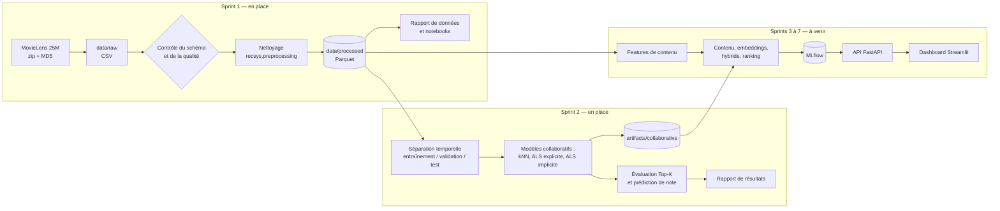

# Recommender System — Intelligent Movie Recommendation Platform

Système de recommandation de films pour une plateforme de streaming fictive, construit sur
MovieLens 25M : filtrage collaboratif, filtrage par contenu, embeddings, modèle hybride et
*learning to rank*, exposés par une API et un dashboard.

> **État d'avancement : Sprints 1 et 2 terminés (données, filtrage collaboratif).** Les sections
> marquées *à venir* décrivent ce qui est prévu, pas ce qui existe. Tous les scores publiés ici
> sortent de `reports/collaborative_results.json`, écrit par l'expérience réellement exécutée.

| Sprint | Contenu | État |
|---|---|---|
| 1 | Initialisation, téléchargement vérifié, exploration, nettoyage, rapport | ✅ fait |
| 2 | Filtrage collaboratif (user-based, item-based, factorisation), protocole d'évaluation | ✅ fait |
| 3 | Filtrage par contenu (TF-IDF) et embeddings | à venir |
| 4 | Système hybride, cold start, diversité | à venir |
| 5 | Learning to rank (XGBoost) | à venir |
| 6 | API FastAPI et dashboard Streamlit | à venir |
| 7 | MLflow, Docker, CI, documentation finale | à venir |

## Problématique

Une plateforme de streaming propose des dizaines de milliers de titres ; un utilisateur n'en
verra qu'une infime partie. Il faut donc choisir, pour chacun, la poignée de films à mettre en
avant — à partir de son historique, des goûts d'utilisateurs proches et du contenu des films —
sans se contenter de recommander les mêmes succès à tout le monde.

## Architecture



Toute la logique vit dans le paquet installable `src/recsys`. Les notebooks, les scripts, et
plus tard l'API et le dashboard, ne font que l'appeler : un calcul n'existe qu'à un seul
endroit, et cet endroit est testé.

```
recommender-system/
├── configs/config.yaml        configuration centrale (dataset, chemins, seuils, graine)
├── data/                      raw / processed / features — jamais versionné
├── docs/DATASET.md            provenance et conditions d'utilisation
├── notebooks/                 01 exploration, 02 prétraitement, 04 filtrage collaboratif
├── reports/                   rapports générés (données, modèles) + figures + résultats JSON
├── scripts/                   points d'entrée en ligne de commande
├── src/recsys/
│   ├── config.py              chargement et validation Pydantic de la configuration
│   ├── data/                  téléchargement vérifié, schémas, chargement, contrôles qualité
│   ├── preprocessing/         nettoyage (fonctions pures) et pipeline
│   ├── analysis/              statistiques, graphiques, génération des rapports
│   ├── evaluation/            séparation temporelle, métriques, protocole
│   ├── models/                contrat commun + modèles collaboratifs
│   ├── experiments/           entraînement, sélection sur validation, mesure sur test
│   ├── utils/                 journalisation, graines aléatoires
│   └── features/              vide pour l'instant (Sprint 3)
└── tests/                     91 tests Pytest
```

## Technologies

Seules les bibliothèques réellement utilisées par le code existant sont installées ; les autres
arriveront avec le sprint qui en a besoin.

| Outil | Rôle |
|---|---|
| Python 3.11 | Version cible |
| Pandas 3, NumPy 2 | Chargement, nettoyage, statistiques |
| PyArrow / Parquet | Stockage intermédiaire typé et compact |
| Pydantic, PyYAML | Configuration validée |
| SciPy (matrices creuses) | Matrice utilisateur × film, similarités, kNN |
| implicit | ALS pour retours implicites |
| Matplotlib | Figures des rapports et des notebooks |
| Pytest, Ruff | Tests et qualité du code |
| Jupyter | Notebooks d'exploration |

## Dataset

MovieLens 25M (GroupLens). Provenance, licence et justification du choix : [docs/DATASET.md](docs/DATASET.md).
Rapport chiffré complet, généré à partir des données : [reports/data_report.md](reports/data_report.md).

### Ce que les données contiennent

| | |
|---|---|
| Notes | 25 000 095 |
| Utilisateurs | 162 541 |
| Films au catalogue | 62 423, dont 59 047 notés au moins une fois |
| Densité de la matrice utilisateur × film | 0,26 % |
| Note moyenne / médiane | 3,53 / 3,5 |
| Période | 9 janvier 1995 – 21 novembre 2019 |
| Tags | 1 093 360 applications, sur 72,5 % du catalogue |

### Qualité

Les données brutes sont propres : aucune valeur manquante dans les notes, aucun doublon
(utilisateur, film), aucune note hors de l'échelle 0,5–5, aucune référence à un film absent
du catalogue. Les seuls défauts relevés :

- 16 tags manquants (27 lignes de tags retirées après normalisation et dédoublonnage) ;
- 107 films sans identifiant TMDB ;
- 5 062 films sans genre et 412 titres sans année — laissés vides, rien n'est inventé ;
- 98 titres portés par plusieurs `movieId` — conservés tels quels, faute de preuve qu'il s'agit
  du même film.

### Constats qui orientent la modélisation


1. **Longue traîne très marquée.** La moitié des films notés ont 6 notes ou moins, et 1 % des
   films concentrent 47,6 % des notes. Un modèle naïf recommandera surtout des succès : il
   faudra mesurer la couverture du catalogue, pas seulement la précision.
2. **Notes biaisées vers le haut.** 49,8 % des notes valent 4 ou plus, 12,8 % valent 2 ou moins.
   Le seuil qui définira une interaction « positive » devra être justifié (Sprint 2).
3. **Chaque utilisateur a son échelle.** La note moyenne par utilisateur va de 2,9 (5ᵉ centile)
   à 4,4 (95ᵉ centile) : les modèles collaboratifs devront centrer les notes.
4. **La plupart des utilisateurs notent en une seule session.** 60,4 % ont déposé toutes leurs
   notes en moins de 24 heures. Avec une coupure temporelle globale à 80 % des notes, seuls
   20,6 % des utilisateurs de test ont un historique d'entraînement. Le protocole
   d'évaluation devra en tenir compte : c'est la première décision du Sprint 2.
5. **Le contenu textuel est inégal.** 27,5 % des films n'ont aucun tag, et la médiane est de
   5 tags distincts par film tagué. L'approche par contenu devra s'appuyer aussi sur les genres
   et le titre.

### Nettoyage et jeu `interactions`

Le pipeline écrit cinq fichiers Parquet dans `data/processed/` : `ratings`, `movies` (année
extraite du titre, genres en liste), `tags` (texte normalisé), `links`, et `interactions`.

`interactions` est le jeu destiné aux modèles collaboratifs. Il ne garde que les utilisateurs
et les films ayant au moins 20 notes, par filtrage itératif. Effet mesuré de ce seuil :

| Minimum de notes par film | Notes conservées | Films conservés | Densité |
|---|---|---|---|
| 1 (aucun filtre) | 100,00 % | 59 047 | 0,260 % |
| 5 | 99,78 % | 32 711 | 0,469 % |
| 10 | 99,56 % | 24 324 | 0,630 % |
| **20 (retenu)** | **99,23 %** | **18 424** | **0,829 %** |
| 50 | 98,56 % | 13 172 | 1,153 % |
| 100 | 97,74 % | 10 322 | 1,461 %  |

Le seuil de 20 écarte 69 % des films notés pour moins de 1 % des notes : ces films n'apportent
presque aucun signal collaboratif. Ils restent dans `movies.parquet` et relèveront des approches
par contenu (cold start film). Le seuil se règle dans `configs/config.yaml`.

## Filtrage collaboratif (Sprint 2)

Rapport complet généré : [reports/collaborative_report.md](reports/collaborative_report.md).
Démonstration commentée : [notebooks/04_collaborative_filtering.ipynb](notebooks/04_collaborative_filtering.ipynb).

### Méthodologie d'évaluation

Le protocole imite la production : on apprend sur le passé, on recommande pour le futur.

| Jeu | Notes d'entraînement | Période évaluée | Utilisateurs évalués |
|---|---|---|---|
| Validation (choix des hyperparamètres) | 19,9 M, jusqu'au 25 juin 2016 | jusqu'au 4 janvier 2018 | 5 006 |
| Test (mesure finale) | 22,4 M, jusqu'au 4 janvier 2018 | jusqu'au 21 novembre 2019 | 6 206 |

- **Aucune fuite** : rien de postérieur à la coupure n'entre dans l'entraînement, y compris pour
  décider quels films ont assez de notes. Le test ne sert jamais à choisir un hyperparamètre.
- **Film pertinent** : note ≥ 4. Une absence de note n'est jamais traitée comme un avis négatif
  à l'entraînement.
- **Candidats** : tous les films du catalogue d'entraînement que l'utilisateur n'a pas encore notés
  (16 007 films), sans échantillonnage de négatifs.
- **Métriques** : Precision, Recall, F1, MAP et NDCG à 5, 10 et 20 ; couverture du catalogue ;
  RMSE et MAE pour les modèles qui prédisent une note.

Deux limites à garder en tête en lisant les scores :

- un film recommandé que l'utilisateur n'a jamais noté compte comme une erreur, même s'il lui
  aurait plu. Les valeurs absolues sont donc des bornes basses ; ce sont les écarts entre modèles
  qui s'interprètent ;
- les utilisateurs évalués sont ceux qui reviennent après la coupure, donc de gros utilisateurs
  (historique médian de 275 notes). Les 11 950 utilisateurs apparus pendant la période de test
  n'ont aucun historique : ils relèvent du cold start (Sprint 4).

### Modèles

| Modèle | Principe | Sortie |
|---|---|---|
| Popularité | Films ayant reçu le plus de notes ≥ 4 | classement |
| Biais | Moyenne globale + biais utilisateur + biais film, amortis | note et classement |
| Item-kNN | Similarité cosinus entre films sur les résidus du modèle de biais, 50 voisins | note et classement |
| User-kNN | Même principe entre utilisateurs, 200 voisins cherchés à la demande | note et classement |
| ALS explicite | Factorisation des résidus sur les notes observées (implémentation NumPy du projet) | note et classement |
| ALS implicite | Factorisation du signal binaire « a aimé » (bibliothèque `implicit`) | classement |

### Résultats sur le test

| Modèle | Precision@10 | Recall@10 | MAP@10 | NDCG@10 | Couverture@10 | RMSE | MAE |
|---|---|---|---|---|---|---|---|
| Popularité | 0,0654 | 0,0319 | 0,0406 | 0,0786 | 1,9 % | — | — |
| Biais | 0,0463 | 0,0278 | 0,0264 | 0,0559 | 0,6 % | 0,8710 | 0,6461 |
| Item-kNN | 0,0881 | 0,0414 | 0,0551 | 0,1029 | **24,4 %** | 0,8681 | 0,6324 |
| User-kNN | 0,0816 | 0,0363 | 0,0510 | 0,0953 | 11,6 % | 0,8976 | 0,6633 |
| ALS explicite | 0,0322 | 0,0221 | 0,0170 | 0,0376 | 17,1 % | **0,8263** | **0,6040** |
| ALS implicite | **0,1202** | **0,0597** | **0,0747** | **0,1381** | 12,6 % | — | — |


### Ce qu'il faut en retenir

1. **L'ALS implicite est le meilleur pour recommander** : NDCG@10 de 0,138 contre 0,079 pour la
   popularité, soit 76 % de mieux. En moyenne, 12 % de ses dix recommandations sont des films
   que l'utilisateur a réellement aimés ensuite.
2. **Bien prédire une note n'est pas bien recommander.** L'ALS explicite a la meilleure RMSE
   (0,826) mais le plus mauvais classement, sous la popularité. Il apprend à estimer la note des
   films qu'un utilisateur choisit de noter, pas à deviner lesquels il choisira. C'est la raison
   pour laquelle le projet évalue les deux familles de métriques séparément.
3. **L'item-kNN offre le meilleur compromis pertinence / diversité** : 31 % de mieux que la
   popularité en NDCG@10, tout en recommandant 24 % du catalogue contre 2 %. Il est en plus
   explicable (« parce que vous avez aimé… ») et se sert en 1,7 ms par utilisateur.
4. **Le user-kNN est le plus coûteux à servir** : 45 ms par utilisateur, 26 fois plus que
   l'item-kNN, pour un résultat inférieur. Sa RMSE (0,898) est même moins bonne que celle du
   simple modèle de biais (0,871) : en l'état, il n'apporte rien à la prédiction de note.
5. **Les gros historiques sont les plus difficiles.** Le NDCG@10 de l'ALS implicite passe de 0,166
   pour les utilisateurs de 5 à 50 notes à 0,120 pour ceux de 401 à 1 000 notes.
6. **Biais de popularité mesuré.** Les films du top-10 de l'ALS implicite ont en moyenne 20 400
   notes d'entraînement, contre 12 100 pour l'item-kNN. La diversité sera traitée au Sprint 4.

### Limites de ce sprint

- Grilles d'hyperparamètres volontairement petites (2 ou 3 configurations par modèle) : le
  user-kNN prend 7 minutes par évaluation et l'ALS explicite 7 à 12 minutes par entraînement.
- Un seul découpage temporel et une seule graine : pas d'intervalle de confiance sur les écarts.
- Les modèles sauvegardés sont entraînés jusqu'au 4 janvier 2018 (la période de test est exclue).
  Un réentraînement sur toutes les données est prévu avant la mise en service (Sprint 6).
- Aucun modèle de ce sprint ne sait répondre à un utilisateur ou un film inconnu.

## Installation

Prérequis : Python 3.11, environ 2 Go d'espace disque pour les données.

```bash
python -m venv .venv
```

```bash
.venv\Scripts\activate          # Windows ; sous Linux/macOS : source .venv/bin/activate
```

```bash
pip install -r requirements-dev.txt
```

```bash
pip install --no-deps -e .
```

## Utilisation

```bash
python scripts/download_data.py
```

Télécharge l'archive (262 Mo), vérifie sa somme MD5, l'extrait et contrôle les colonnes des CSV.

```bash
python scripts/prepare_data.py
```

Contrôle qualité puis nettoyage vers `data/processed/` (environ 1 minute, pic mémoire de
quelques Go).

```bash
python scripts/build_data_report.py
```

Régénère `reports/data_report.md` et ses figures.

```bash
python scripts/train_collaborative.py
```

Entraîne, sélectionne sur la validation et mesure sur le test les six modèles collaboratifs
(environ une heure sur un portable 8 cœurs / 16 Go). Ajouter `--sample-users 5000` pour un essai
de moins d'une minute, dont les résultats sont écrits à part dans `reports/sample/`.

```bash
python scripts/build_model_report.py
```

Régénère `reports/collaborative_report.md` à partir des résultats.

```bash
jupyter lab notebooks
```

Avec `make` (Linux, macOS, CI) : `make install`, `make all`, `make train`, `make test`, `make lint`.

## Tests

```bash
python -m pytest
```

```bash
python -m ruff check .
```

Les 91 tests tournent en quelques secondes sur des jeux miniatures, sans avoir besoin du
dataset réel. Ils couvrent :

- **données** : configuration, téléchargement (somme de contrôle, archive corrompue, refus d'une
  archive qui écrirait hors du dossier cible), schéma inattendu, contrôles qualité, règles de
  nettoyage, pipeline jusqu'au rapport ;
- **évaluation** : chaque métrique sur un cas calculé à la main, absence de fuite dans la
  séparation temporelle (y compris pour le filtre de popularité des films), protocole vérifié
  avec un modèle « oracle » et un modèle « pire cas » ;
- **modèles** : sur un jeu à deux communautés, chaque modèle personnalisé doit recommander le
  film manquant du bon genre ; exclusion des films déjà notés ; repli sur le modèle de biais
  sans voisin ; décroissance de l'erreur de l'ALS ; reproductibilité à graine fixée ;
  sauvegarde et rechargement à l'identique ;
- **expérience** : exécution de bout en bout et vérification que l'hyperparamètre retenu est bien
  celui de la validation.

## Reproductibilité

- Versions figées dans `requirements.txt` (exécution) et `requirements-dev.txt` (environnement
  complet), produites par `pip freeze` après installation et exécution réelles.
- Archive vérifiée par somme MD5 avant extraction.
- Graine aléatoire unique dans `configs/config.yaml`, appliquée par `recsys.utils.seed.set_seed`.
- Le rapport et les notebooks sont régénérables par une commande.

## Limites actuelles

- Pas encore d'approche par contenu, d'API ni de dashboard ; les modèles collaboratifs ne
  traitent pas le cold start.
- MovieLens ne fournit ni description de film ni données de visionnage : les « habitudes de
  visionnage » se limiteront aux notes et à leur horodatage.
- Les notes s'arrêtent en 2019 et proviennent d'utilisateurs ayant noté au moins 20 films :
  le dataset ne contient pas de vrais utilisateurs débutants, il faudra les simuler pour
  évaluer le cold start.
- Les fichiers *tag genome* de l'archive ne sont pas encore exploités.
- La CI GitHub Actions et Docker sont prévus au Sprint 7.

## Données et licence

Les données MovieLens ne sont pas redistribuées dans ce dépôt (voir [docs/DATASET.md](docs/DATASET.md)).

> F. Maxwell Harper and Joseph A. Konstan. 2015. The MovieLens Datasets: History and Context.
> ACM Transactions on Interactive Intelligent Systems (TiiS) 5, 4: 19:1–19:19.
