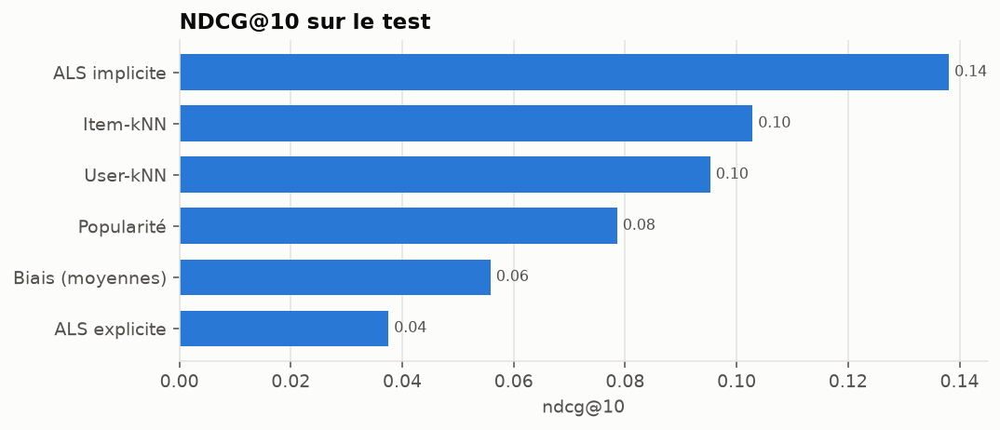
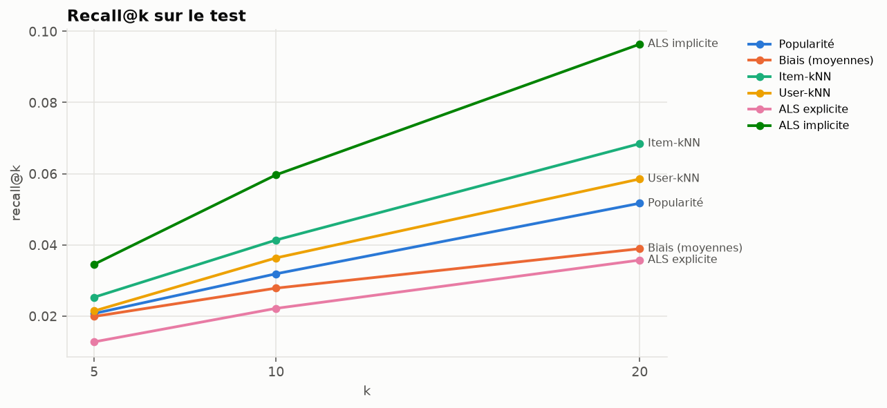
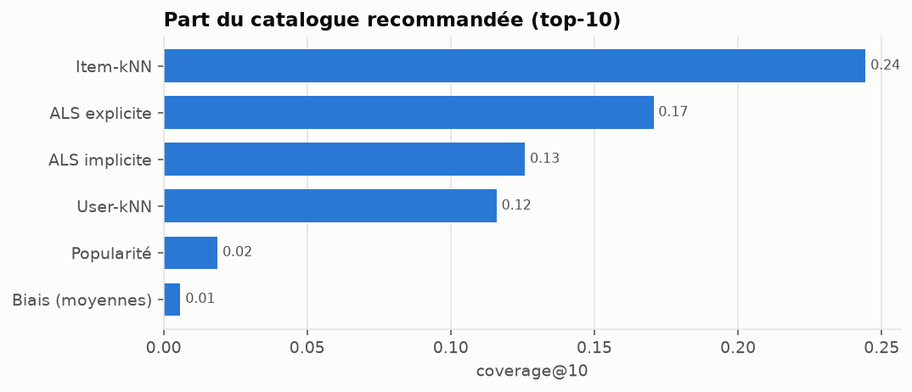
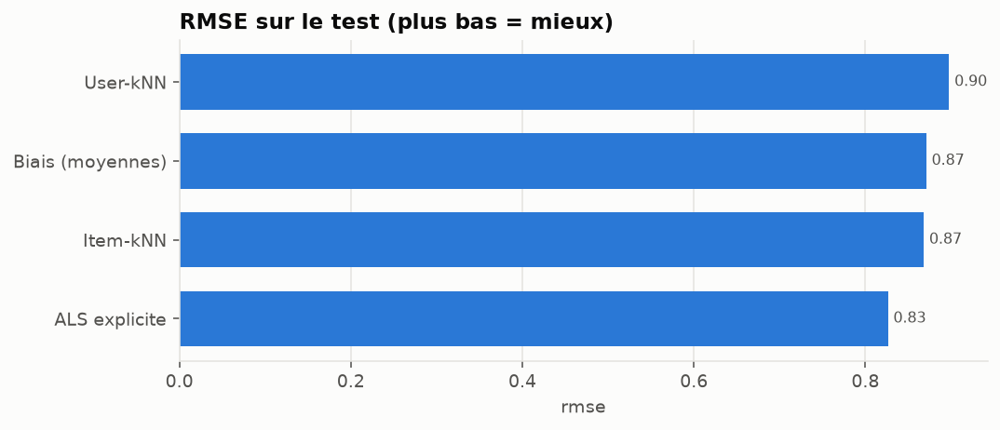

# Filtrage collaboratif — résultats

> Fichier généré par `python scripts/build_model_report.py` à partir de
> `reports/collaborative_results.json`. Ne pas éditer à la main.

## Protocole

- Coupures temporelles globales aux quantiles 0.8 et 0.9 des notes classées par date.
- Film pertinent : note ≥ 4.0.
- Candidats : tous les films du catalogue d'entraînement non encore notés par l'utilisateur.
- Graine aléatoire : 42.

| jeu | train_end | train_ratings | train_users | train_items | holdout_ratings | holdout_users | holdout_cold_users | eval_users | eval_relevant |
| --- | --- | --- | --- | --- | --- | --- | --- | --- | --- |
| validation | 2016-06-25T06:49:57.600000+00:00 | 19,905,544 | 137,883 | 13,980 | 2,500,009 | 18,003 | 12,708 | 5,006 | 137,353 |
| test | 2018-01-04T02:45:00.800000+00:00 | 22,366,789 | 150,591 | 16,007 | 2,500,010 | 18,442 | 11,950 | 6,206 | 165,779 |

## Résultats sur le test

### Top-5

| modèle | precision@5 | recall@5 | f1@5 | map@5 | ndcg@5 | coverage@5 |
| --- | --- | --- | --- | --- | --- | --- |
| Popularité | 0.0781 | 0.0207 | 0.0248 | 0.0545 | 0.0861 | 0.0131 |
| Biais (moyennes) | 0.0569 | 0.0199 | 0.0218 | 0.0360 | 0.0605 | 0.0029 |
| Item-kNN | 0.1033 | 0.0253 | 0.0319 | 0.0741 | 0.1118 | 0.1794 |
| User-kNN | 0.0949 | 0.0214 | 0.0278 | 0.0686 | 0.1038 | 0.0853 |
| ALS explicite | 0.0334 | 0.0127 | 0.0133 | 0.0209 | 0.0360 | 0.1153 |
| ALS implicite | 0.1336 | 0.0345 | 0.0429 | 0.0953 | 0.1446 | 0.1010 |

### Top-10

| modèle | precision@10 | recall@10 | f1@10 | map@10 | ndcg@10 | coverage@10 |
| --- | --- | --- | --- | --- | --- | --- |
| Popularité | 0.0654 | 0.0319 | 0.0310 | 0.0406 | 0.0786 | 0.0188 |
| Biais (moyennes) | 0.0463 | 0.0278 | 0.0248 | 0.0264 | 0.0559 | 0.0059 |
| Item-kNN | 0.0881 | 0.0414 | 0.0423 | 0.0551 | 0.1029 | 0.2444 |
| User-kNN | 0.0816 | 0.0363 | 0.0376 | 0.0510 | 0.0953 | 0.1159 |
| ALS explicite | 0.0322 | 0.0221 | 0.0183 | 0.0170 | 0.0376 | 0.1706 |
| ALS implicite | 0.1202 | 0.0597 | 0.0595 | 0.0747 | 0.1381 | 0.1258 |

### Top-20

| modèle | precision@20 | recall@20 | f1@20 | map@20 | ndcg@20 | coverage@20 |
| --- | --- | --- | --- | --- | --- | --- |
| Popularité | 0.0564 | 0.0517 | 0.0383 | 0.0326 | 0.0766 | 0.0272 |
| Biais (moyennes) | 0.0349 | 0.0389 | 0.0261 | 0.0206 | 0.0521 | 0.0099 |
| Item-kNN | 0.0738 | 0.0684 | 0.0519 | 0.0434 | 0.0992 | 0.3292 |
| User-kNN | 0.0684 | 0.0585 | 0.0459 | 0.0397 | 0.0906 | 0.1595 |
| ALS explicite | 0.0291 | 0.0357 | 0.0225 | 0.0146 | 0.0400 | 0.2491 |
| ALS implicite | 0.1020 | 0.0964 | 0.0727 | 0.0610 | 0.1349 | 0.1531 |

### Prédiction de note

| modèle | rmse | mae |
| --- | --- | --- |
| Biais (moyennes) | 0.8710 | 0.6461 |
| Item-kNN | 0.8681 | 0.6324 |
| User-kNN | 0.8976 | 0.6633 |
| ALS explicite | 0.8263 | 0.6040 |

### Coût et biais de popularité

| modèle | hyperparamètres retenus | entraînement (s) | ms / utilisateur | popularité moyenne du top-10 |
| --- | --- | --- | --- | --- |
| Popularité | relevance_threshold=4.0 | 0.2 | 0.3 | 49,957.1 |
| Biais (moyennes) | reg_item=25, reg_user=10 | 1.0 | 0.3 | 19,299.4 |
| Item-kNN | k=50, shrinkage=100 | 92.3 | 1.7 | 12,068.0 |
| User-kNN | k=200, shrinkage=50 | 4.7 | 45.0 | 19,846.1 |
| ALS explicite | factors=32, reg=0.05, iterations=10 | 699.5 | 1.1 | 3,421.0 |
| ALS implicite | factors=64, reg=0.01, alpha=10, iterations=15, relevance_threshold=4.0 | 111.6 | 0.8 | 20,408.4 |

## Analyse d'erreurs : NDCG@10 selon la taille de l'historique

| historique | utilisateurs | ALS explicite | ALS implicite | Biais (moyennes) | Item-kNN | Popularité | User-kNN |
| --- | --- | --- | --- | --- | --- | --- | --- |
| 5-50 | 703 | 0.0392 | 0.1657 | 0.0595 | 0.1451 | 0.1192 | 0.1206 |
| 51-150 | 1,295 | 0.0264 | 0.1548 | 0.0508 | 0.1189 | 0.0880 | 0.1055 |
| 151-400 | 1,872 | 0.0296 | 0.1357 | 0.0471 | 0.0978 | 0.0658 | 0.0874 |
| 401-1000 | 1,610 | 0.0441 | 0.1204 | 0.0627 | 0.0826 | 0.0682 | 0.0869 |
| > 1000 | 726 | 0.0619 | 0.1270 | 0.0691 | 0.0916 | 0.0786 | 0.0917 |

## Sélection des hyperparamètres (validation)

| modèle | params | ndcg@10 | recall@10 | coverage@10 | rmse | fit_seconds |
| --- | --- | --- | --- | --- | --- | --- |
| Popularité | relevance_threshold=4.0 | 0.0869 | 0.0337 | 0.0195 |  | 0.2035 |
| Biais (moyennes) | reg_item=5, reg_user=5 | 0.0635 | 0.0266 | 0.0068 | 0.8692 | 0.8625 |
| Biais (moyennes) | reg_item=25, reg_user=10 | 0.0597 | 0.0228 | 0.0089 | 0.8680 | 0.8322 |
| Item-kNN | k=50, shrinkage=0 | 0.1150 | 0.0503 | 0.3268 | 0.8679 | 43.4275 |
| Item-kNN | k=50, shrinkage=100 | 0.1198 | 0.0527 | 0.2491 | 0.8602 | 79.7212 |
| Item-kNN | k=200, shrinkage=100 | 0.1187 | 0.0506 | 0.2481 | 0.8325 | 77.5638 |
| User-kNN | k=50, shrinkage=0 | 0.0965 | 0.0399 | 0.1904 | 0.9139 | 4.3478 |
| User-kNN | k=200, shrinkage=50 | 0.1107 | 0.0439 | 0.1220 | 0.8871 | 4.1454 |
| ALS explicite | factors=32, reg=0.05, iterations=10 | 0.0400 | 0.0218 | 0.1825 | 0.8179 | 423.9797 |
| ALS explicite | factors=32, reg=0.1, iterations=10 | 0.0631 | 0.0295 | 0.0461 | 0.8334 | 472.8584 |
| ALS implicite | factors=64, reg=0.01, alpha=10, iterations=15, relevance_threshold=4.0 | 0.1504 | 0.0704 | 0.1318 |  | 79.2214 |
| ALS implicite | factors=128, reg=0.01, alpha=10, iterations=15, relevance_threshold=4.0 | 0.1477 | 0.0673 | 0.1456 |  | 148.5344 |
| ALS implicite | factors=128, reg=0.1, alpha=40, iterations=15, relevance_threshold=4.0 | 0.1172 | 0.0560 | 0.2039 |  | 136.1046 |
