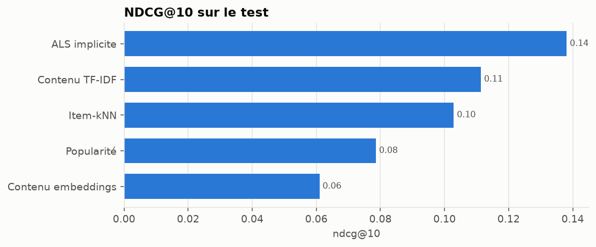
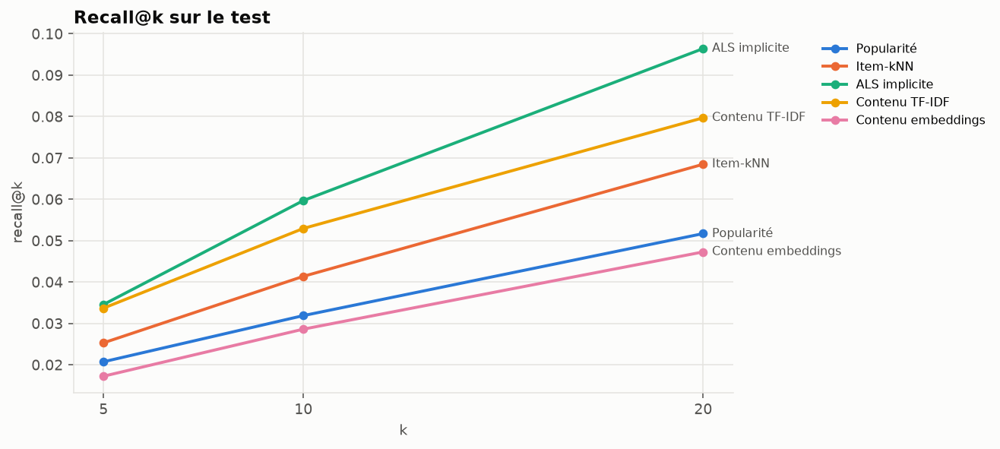
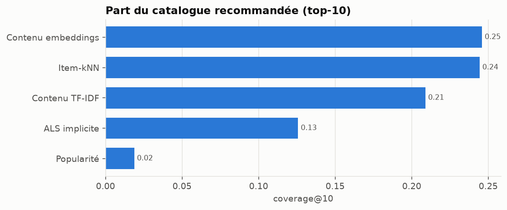
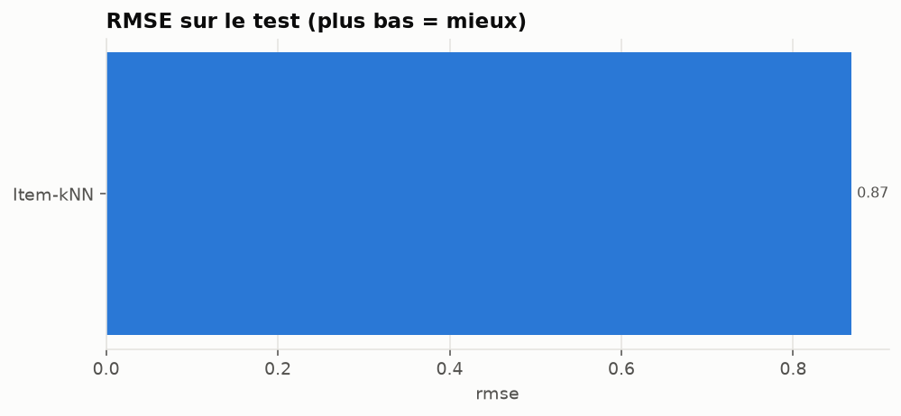

# Filtrage par contenu et embeddings — résultats

> Fichier généré par `python scripts/build_model_report.py` à partir de
> `reports/content_results.json`. Ne pas éditer à la main.

## Protocole

- Coupures temporelles globales aux quantiles 0.8 et 0.9 des notes classées par date.
- Film pertinent : note ≥ 4.0.
- Candidats : tous les films du catalogue d'entraînement non encore notés par l'utilisateur.
- Graine aléatoire : 42.

| jeu | train_end | train_ratings | train_users | train_items | holdout_ratings | holdout_users | holdout_cold_users | eval_users | eval_relevant |
| --- | --- | --- | --- | --- | --- | --- | --- | --- | --- |
| validation | 2016-06-25T06:49:57.600000+00:00 | 19,905,544 | 137,883 | 13,980 | 2,500,009 | 18,003 | 12,708 | 5,006 | 137,353 |
| test | 2018-01-04T02:45:00.800000+00:00 | 22,366,789 | 150,591 | 16,007 | 2,500,010 | 18,442 | 11,950 | 6,206 | 165,779 |

## Résultats sur le test

Modèles de référence repris de `reports/collaborative_results.json` (même jeu de test).

### Top-5

| modèle | precision@5 | recall@5 | f1@5 | map@5 | ndcg@5 | coverage@5 |
| --- | --- | --- | --- | --- | --- | --- |
| Popularité | 0.0781 | 0.0207 | 0.0248 | 0.0545 | 0.0861 | 0.0131 |
| Item-kNN | 0.1033 | 0.0253 | 0.0319 | 0.0741 | 0.1118 | 0.1794 |
| ALS implicite | 0.1336 | 0.0345 | 0.0429 | 0.0953 | 0.1446 | 0.1010 |
| Contenu TF-IDF | 0.1074 | 0.0337 | 0.0387 | 0.0781 | 0.1215 | 0.1363 |
| Contenu embeddings | 0.0609 | 0.0172 | 0.0203 | 0.0373 | 0.0649 | 0.1709 |

### Top-10

| modèle | precision@10 | recall@10 | f1@10 | map@10 | ndcg@10 | coverage@10 |
| --- | --- | --- | --- | --- | --- | --- |
| Popularité | 0.0654 | 0.0319 | 0.0310 | 0.0406 | 0.0786 | 0.0188 |
| Item-kNN | 0.0881 | 0.0414 | 0.0423 | 0.0551 | 0.1029 | 0.2444 |
| ALS implicite | 0.1202 | 0.0597 | 0.0595 | 0.0747 | 0.1381 | 0.1258 |
| Contenu TF-IDF | 0.0890 | 0.0529 | 0.0482 | 0.0572 | 0.1113 | 0.2090 |
| Contenu embeddings | 0.0523 | 0.0286 | 0.0267 | 0.0272 | 0.0610 | 0.2460 |

### Top-20

| modèle | precision@20 | recall@20 | f1@20 | map@20 | ndcg@20 | coverage@20 |
| --- | --- | --- | --- | --- | --- | --- |
| Popularité | 0.0564 | 0.0517 | 0.0383 | 0.0326 | 0.0766 | 0.0272 |
| Item-kNN | 0.0738 | 0.0684 | 0.0519 | 0.0434 | 0.0992 | 0.3292 |
| ALS implicite | 0.1020 | 0.0964 | 0.0727 | 0.0610 | 0.1349 | 0.1531 |
| Contenu TF-IDF | 0.0723 | 0.0797 | 0.0547 | 0.0455 | 0.1068 | 0.3182 |
| Contenu embeddings | 0.0435 | 0.0472 | 0.0324 | 0.0212 | 0.0599 | 0.3525 |

### Prédiction de note

| modèle | rmse | mae |
| --- | --- | --- |
| Item-kNN | 0.8681 | 0.6324 |

### Coût et biais de popularité

| modèle | hyperparamètres retenus | entraînement (s) | ms / utilisateur | popularité moyenne du top-10 |
| --- | --- | --- | --- | --- |
| Popularité | relevance_threshold=4.0 | 0.2 | 0.3 | 49,957.1 |
| Item-kNN | k=50, shrinkage=100 | 92.3 | 1.7 | 12,068.0 |
| ALS implicite | factors=64, reg=0.01, alpha=10, iterations=15, relevance_threshold=4.0 | 111.6 | 0.8 | 20,408.4 |
| Contenu TF-IDF | genre_weight=0.2, tag_weight=1.0, title_weight=0.3, aggregation=knn, k=50 | 6.3 | 0.8 | 13,188.5 |
| Contenu embeddings | model=sentence-transformers/all-MiniLM-L6-v2, max_tags=15, aggregation=knn, k=50 | 4.9 | 0.6 | 6,227.9 |

## Analyse d'erreurs : NDCG@10 selon la taille de l'historique

| historique | utilisateurs | ALS implicite | Contenu embeddings | Item-kNN | Popularité | Contenu TF-IDF |
| --- | --- | --- | --- | --- | --- | --- |
| 5-50 | 703 | 0.1657 | 0.0516 | 0.1451 | 0.1192 | 0.1205 |
| 51-150 | 1,295 | 0.1548 | 0.0576 | 0.1189 | 0.0880 | 0.1154 |
| 151-400 | 1,872 | 0.1357 | 0.0599 | 0.0978 | 0.0658 | 0.1125 |
| 401-1000 | 1,610 | 0.1204 | 0.0644 | 0.0826 | 0.0682 | 0.1065 |
| > 1000 | 726 | 0.1270 | 0.0713 | 0.0916 | 0.0786 | 0.1028 |

## Films similaires : TF-IDF contre embeddings

Mesuré sur 2,000 films tirés au hasard, 10 voisins par film.

| moteur | voisins communs avec l'item-kNN | Jaccard des genres |
| --- | --- | --- |
| Contenu TF-IDF | 0.0639 | 0.4678 |
| Contenu embeddings | 0.0510 | 0.4802 |
| Item-kNN (référence collaborative) | 1.0000 | 0.4037 |

- Voisins communs entre TF-IDF et embeddings : **9.9%**
- Recherche exacte dans l'index d'embeddings (62,423 films, dimension 384) : **13.0 ms** en moyenne, 15.5 ms au 95ᵉ centile.

## Sélection des hyperparamètres (validation)

| modèle | params | ndcg@10 | recall@10 | coverage@10 | fit_seconds |
| --- | --- | --- | --- | --- | --- |
| Contenu TF-IDF | genre_weight=1.0, tag_weight=0.0, title_weight=0.0, aggregation=knn, k=50 | 0.0168 | 0.0060 | 0.3507 | 3.9620 |
| Contenu TF-IDF | genre_weight=1.0, tag_weight=1.0, title_weight=0.0, aggregation=centroid, k=50 | 0.0026 | 0.0014 | 0.0818 | 0.2136 |
| Contenu TF-IDF | genre_weight=1.0, tag_weight=1.0, title_weight=0.0, aggregation=knn, k=50 | 0.0571 | 0.0219 | 0.2011 | 4.4988 |
| Contenu TF-IDF | genre_weight=0.5, tag_weight=1.0, title_weight=0.0, aggregation=knn, k=50 | 0.0839 | 0.0353 | 0.1918 | 4.6435 |
| Contenu TF-IDF | genre_weight=0.5, tag_weight=1.0, title_weight=0.3, aggregation=knn, k=50 | 0.0895 | 0.0375 | 0.1853 | 5.2868 |
| Contenu TF-IDF | genre_weight=0.2, tag_weight=1.0, title_weight=0.3, aggregation=knn, k=50 | 0.1028 | 0.0446 | 0.1990 | 4.4399 |
| Contenu TF-IDF | genre_weight=0.0, tag_weight=1.0, title_weight=0.0, aggregation=knn, k=50 | 0.1011 | 0.0446 | 0.2008 | 2.9544 |
| Contenu embeddings | model=sentence-transformers/all-MiniLM-L6-v2, max_tags=15, aggregation=centroid, k=50 | 0.0234 | 0.0111 | 0.0466 | 0.2768 |
| Contenu embeddings | model=sentence-transformers/all-MiniLM-L6-v2, max_tags=15, aggregation=knn, k=50 | 0.0563 | 0.0247 | 0.2448 | 4.2790 |
