# Rapport sur les données — MovieLens

> Fichier généré par `python scripts/build_data_report.py`. Ne pas éditer à la main :
> tous les chiffres sont recalculés à partir des données téléchargées.

## 1. Provenance

- Jeu de données : **ml-25m** (GroupLens Research)
- Source : <https://files.grouplens.org/datasets/movielens/ml-25m.zip>
- Somme MD5 vérifiée au téléchargement : `6b51fb2759a8657d3bfcbfc42b592ada`
- Conditions d'utilisation : voir `docs/DATASET.md`

## 2. Tables, colonnes et qualité des données brutes

### `ratings.csv` — 25,000,095 lignes

| colonne | description | valeurs manquantes |
| --- | --- | --- |
| userId | identifiant anonymisé de l'utilisateur | 0 |
| movieId | identifiant MovieLens du film | 0 |
| rating | note de 0.5 à 5.0 par pas de 0.5 | 0 |
| timestamp | date de la note (secondes Unix, UTC) | 0 |

- Lignes strictement dupliquées : **0**
- Doublons sur la clé (userId, movieId) : **0**

### `movies.csv` — 62,423 lignes

| colonne | description | valeurs manquantes |
| --- | --- | --- |
| movieId | identifiant MovieLens du film | 0 |
| title | titre suivi de l'année de sortie entre parenthèses | 0 |
| genres | genres séparés par une barre verticale | 0 |

- Lignes strictement dupliquées : **0**
- Doublons sur la clé (movieId) : **0**

### `tags.csv` — 1,093,360 lignes

| colonne | description | valeurs manquantes |
| --- | --- | --- |
| userId | identifiant de l'utilisateur qui a posé le tag | 0 |
| movieId | identifiant MovieLens du film | 0 |
| tag | texte libre saisi par l'utilisateur | 16 |
| timestamp | date du tag (secondes Unix, UTC) | 0 |

- Lignes strictement dupliquées : **0**
- Doublons sur la clé (userId, movieId, tag) : **0**

### `links.csv` — 62,423 lignes

| colonne | description | valeurs manquantes |
| --- | --- | --- |
| movieId | identifiant MovieLens du film | 0 |
| imdbId | identifiant IMDb | 0 |
| tmdbId | identifiant TMDB | 107 |

- Lignes strictement dupliquées : **0**
- Doublons sur la clé (movieId) : **0**

### Contrôles de cohérence

- Notes hors bornes : **0**
- Notes hors pas de 0.5 : **0**
- Valeurs de note observées : [0.5, 1.0, 1.5, 2.0, 2.5, 3.0, 3.5, 4.0, 4.5, 5.0]
- Horodatages non positifs : **0**
- Films sans genre (`(no genres listed)`) : **5,062**
- Titres sans année : **412**
- Titres en double (movieId différents) : **98**

| contrôle d'intégrité | films |
| --- | --- |
| rated_movies_missing_from_catalog | 0 |
| tagged_movies_missing_from_catalog | 0 |
| linked_movies_missing_from_catalog | 0 |
| catalog_movies_without_rating | 3,376 |
| catalog_movies_without_tag | 17,172 |
| catalog_movies_without_link | 0 |

## 3. Chiffres clés (après nettoyage)

- Utilisateurs : **162,541**
- Films au catalogue : **62,423**, dont **59,047** ont au moins une note
- Notes : **25,000,095**
- Densité de la matrice utilisateur × film : **0.2605%**
- Note moyenne : **3.534** (médiane 3.5)
- Période : du **1995-01-09** au **2019-11-21**

## 4. Distribution des notes

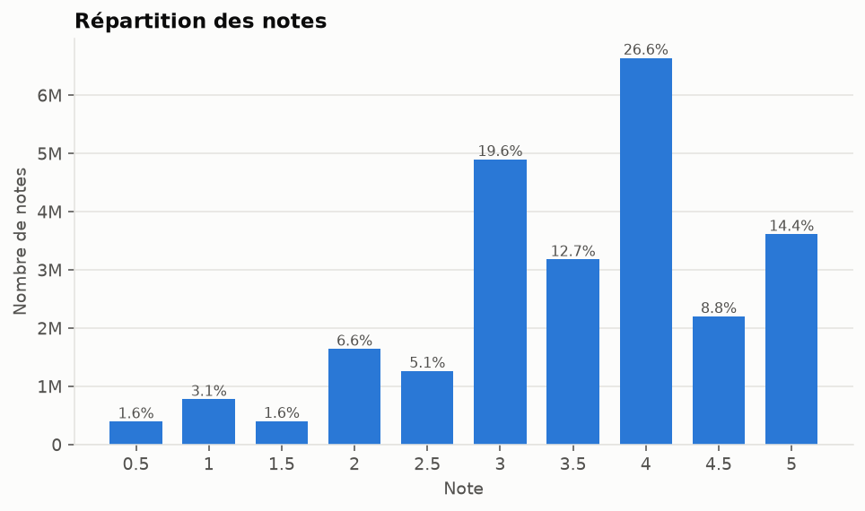

| rating | count | share |
| --- | --- | --- |
| 0.5 | 393,068 | 1.57% |
| 1.0 | 776,815 | 3.11% |
| 1.5 | 399,490 | 1.60% |
| 2.0 | 1,640,868 | 6.56% |
| 2.5 | 1,262,797 | 5.05% |
| 3.0 | 4,896,928 | 19.59% |
| 3.5 | 3,177,318 | 12.71% |
| 4.0 | 6,639,798 | 26.56% |
| 4.5 | 2,200,539 | 8.80% |
| 5.0 | 3,612,474 | 14.45% |

## 5. Comportement des utilisateurs

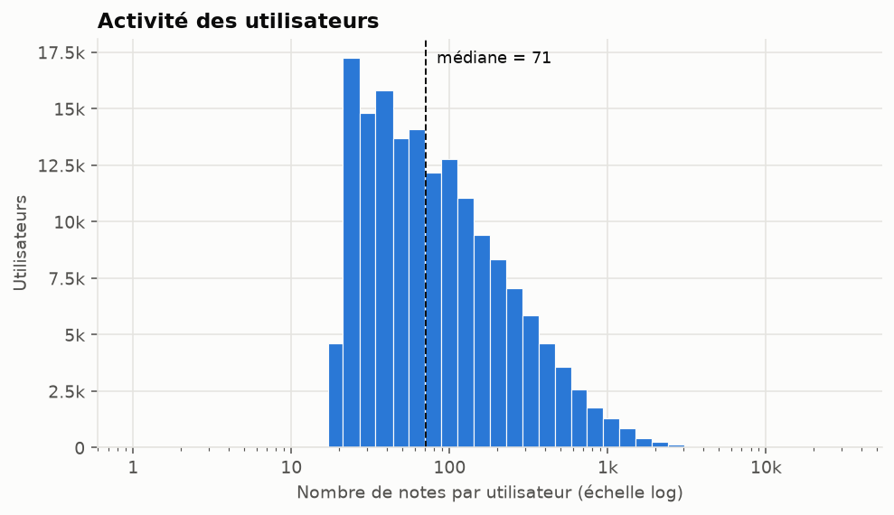

| mesure | count | mean | std | min | 1% | 5% | 25% | 50% | 75% | 95% | 99% | max |
| --- | --- | --- | --- | --- | --- | --- | --- | --- | --- | --- | --- | --- |
| notes par utilisateur | 162,541.0 | 153.8 | 268.0 | 20.0 | 20.0 | 22.0 | 36.0 | 71.0 | 162.0 | 554.0 | 1,228.0 | 32,202.0 |

Utilisateurs peu actifs (au plus *n* notes) :

| max_ratings | n_entities | share_entities | share_ratings |
| --- | --- | --- | --- |
| 1 | 0 | 0.00% | 0.00% |
| 5 | 0 | 0.00% | 0.00% |
| 10 | 0 | 0.00% | 0.00% |
| 20 | 4,611 | 2.84% | 0.37% |
| 50 | 61,467 | 37.82% | 7.85% |
| 100 | 99,439 | 61.18% | 18.74% |

Part des notes déposée par les utilisateurs les plus actifs :

| top_share | n_entities | share_ratings |
| --- | --- | --- |
| 1.00% | 1,625 | 12.14% |
| 5.00% | 8,127 | 32.50% |
| 10.00% | 16,254 | 46.75% |
| 20.00% | 32,508 | 63.98% |

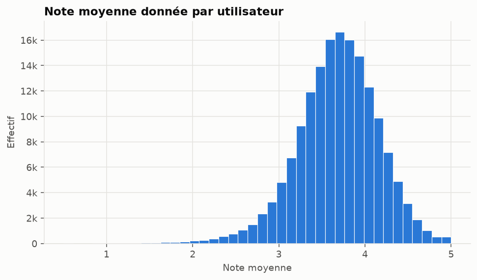

| mesure | count | mean | std | min | 1% | 5% | 25% | 50% | 75% | 95% | 99% | max |
| --- | --- | --- | --- | --- | --- | --- | --- | --- | --- | --- | --- | --- |
| note moyenne par utilisateur | 162,541.000 | 3.679 | 0.477 | 0.500 | 2.339 | 2.879 | 3.399 | 3.700 | 4.000 | 4.409 | 4.707 | 5.000 |

| mesure | count | mean | std | min | 1% | 5% | 25% | 50% | 75% | 95% | 99% | max |
| --- | --- | --- | --- | --- | --- | --- | --- | --- | --- | --- | --- | --- |
| jours entre première et dernière note | 162,541.0 | 221.2 | 716.5 | 0.0 | 0.0 | 0.0 | 0.0 | 0.0 | 40.0 | 1,334.0 | 3,938.8 | 8,101.0 |

## 6. Popularité des films

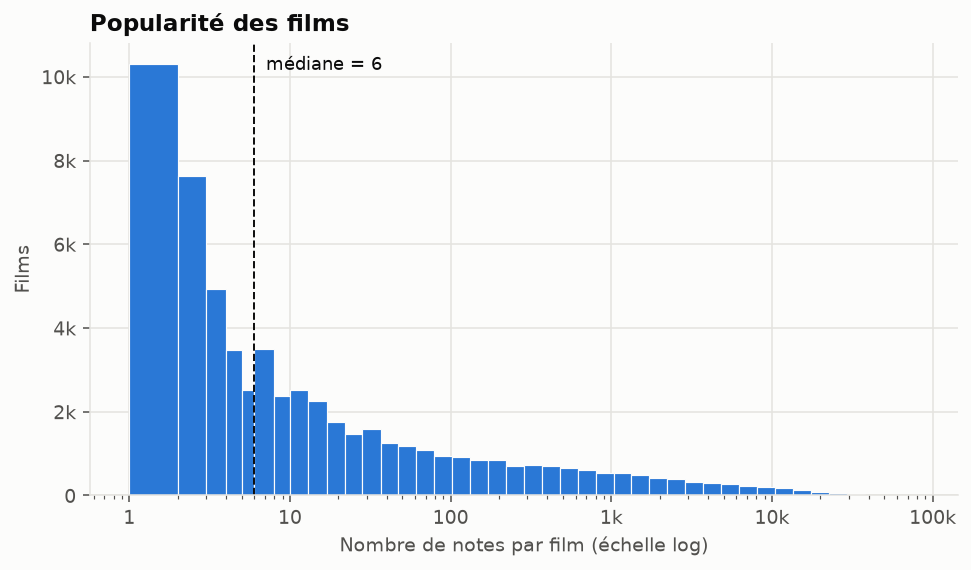

| mesure | count | mean | std | min | 1% | 5% | 25% | 50% | 75% | 95% | 99% | max |
| --- | --- | --- | --- | --- | --- | --- | --- | --- | --- | --- | --- | --- |
| notes par film | 59,047.0 | 423.4 | 2,477.9 | 1.0 | 1.0 | 1.0 | 2.0 | 6.0 | 36.0 | 1,503.4 | 9,941.6 | 81,491.0 |

Films peu notés (au plus *n* notes) :

| max_ratings | n_entities | share_entities | share_ratings |
| --- | --- | --- | --- |
| 1 | 10,298 | 17.44% | 0.04% |
| 5 | 28,840 | 48.84% | 0.27% |
| 10 | 35,690 | 60.44% | 0.48% |
| 20 | 40,917 | 69.30% | 0.78% |
| 50 | 45,960 | 77.84% | 1.44% |
| 100 | 48,756 | 82.57% | 2.24% |

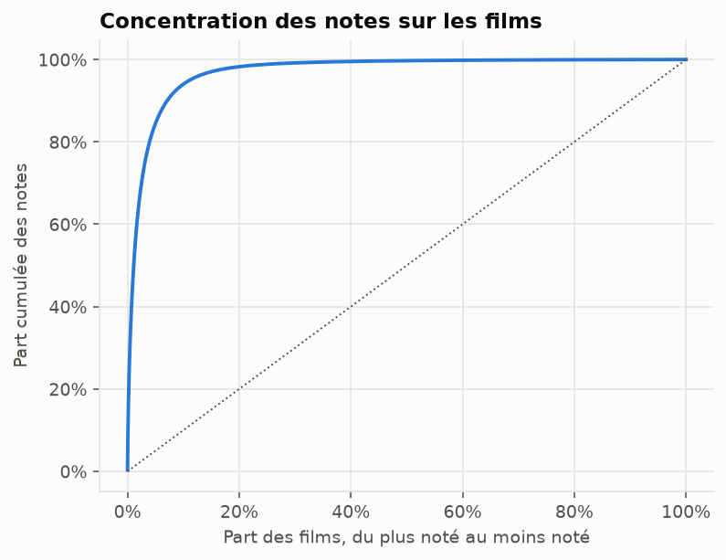

| top_share | n_entities | share_ratings |
| --- | --- | --- |
| 1.00% | 590 | 47.59% |
| 5.00% | 2,952 | 84.45% |
| 10.00% | 5,905 | 94.02% |
| 20.00% | 11,809 | 98.26% |

Les 15 films les plus notés :

| title | n_ratings | mean_rating |
| --- | --- | --- |
| Forrest Gump (1994) | 81,491 | 4.048 |
| Shawshank Redemption, The (1994) | 81,482 | 4.414 |
| Pulp Fiction (1994) | 79,672 | 4.189 |
| Silence of the Lambs, The (1991) | 74,127 | 4.151 |
| Matrix, The (1999) | 72,674 | 4.154 |
| Star Wars: Episode IV - A New Hope (1977) | 68,717 | 4.120 |
| Jurassic Park (1993) | 64,144 | 3.679 |
| Schindler's List (1993) | 60,411 | 4.248 |
| Braveheart (1995) | 59,184 | 4.002 |
| Fight Club (1999) | 58,773 | 4.228 |
| Terminator 2: Judgment Day (1991) | 57,379 | 3.946 |
| Star Wars: Episode V - The Empire Strikes Back (1980) | 57,361 | 4.144 |
| Toy Story (1995) | 57,309 | 3.894 |
| Lord of the Rings: The Fellowship of the Ring, The (2001) | 55,736 | 4.091 |
| Usual Suspects, The (1995) | 55,366 | 4.284 |

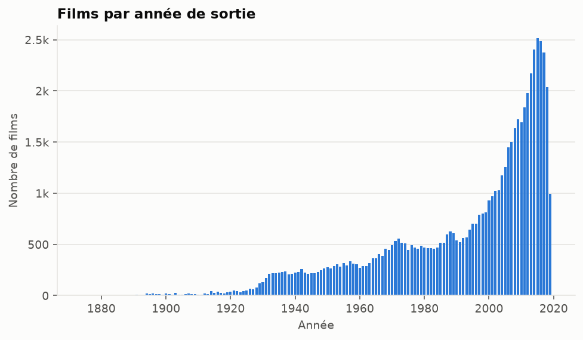

## 7. Genres

Un film à plusieurs genres compte dans chacun d'eux.

| genre | n_movies | n_ratings | mean_rating |
| --- | --- | --- | --- |
| Drama | 25,606 | 10,962,833 | 3.677 |
| Comedy | 16,870 | 8,926,230 | 3.424 |
| Action | 7,348 | 7,446,918 | 3.467 |
| Thriller | 8,654 | 6,763,272 | 3.523 |
| Adventure | 4,145 | 5,832,424 | 3.517 |
| Romance | 7,719 | 4,497,291 | 3.543 |
| Sci-Fi | 3,595 | 4,325,740 | 3.478 |
| Crime | 5,319 | 4,190,259 | 3.685 |
| Fantasy | 2,731 | 2,831,585 | 3.512 |
| Children | 2,935 | 2,124,258 | 3.433 |
| Mystery | 2,925 | 2,010,995 | 3.670 |
| Horror | 5,989 | 1,892,183 | 3.294 |
| Animation | 2,929 | 1,630,987 | 3.615 |
| War | 1,874 | 1,267,346 | 3.791 |
| IMAX | 195 | 1,063,279 | 3.604 |
| Musical | 1,054 | 964,252 | 3.555 |
| Western | 1,399 | 483,731 | 3.586 |
| Documentary | 5,605 | 322,449 | 3.705 |
| Film-Noir | 353 | 247,227 | 3.926 |

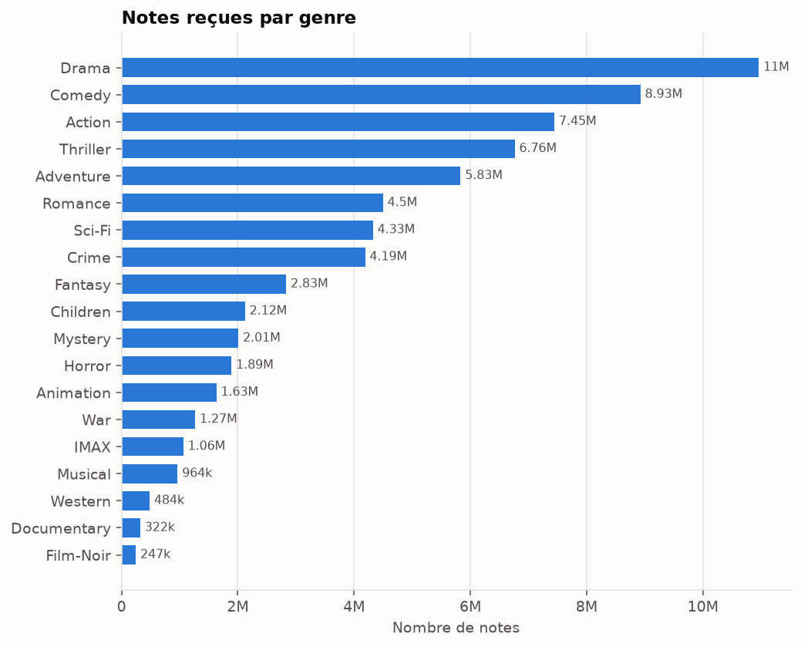

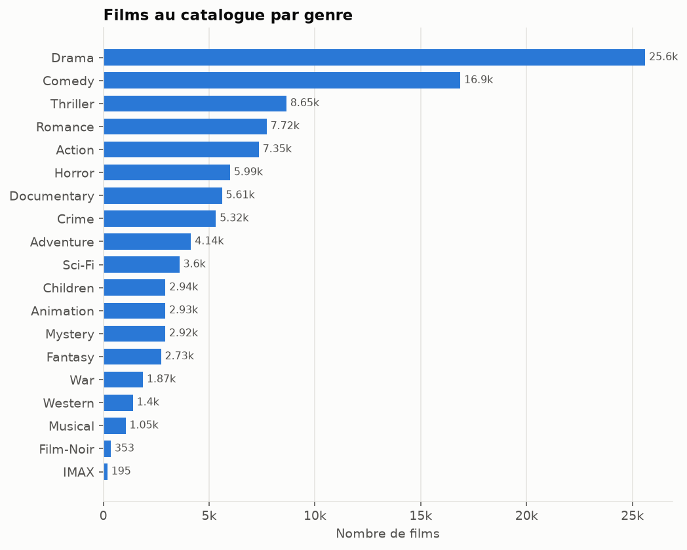

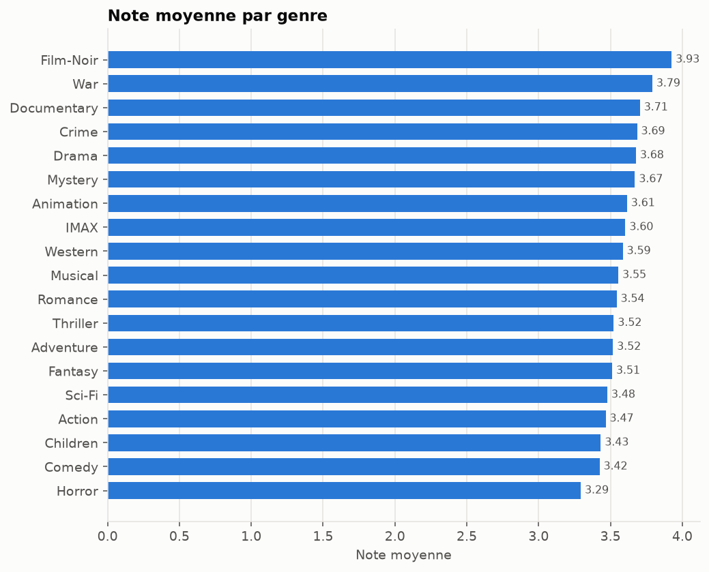

## 8. Dimension temporelle et tags

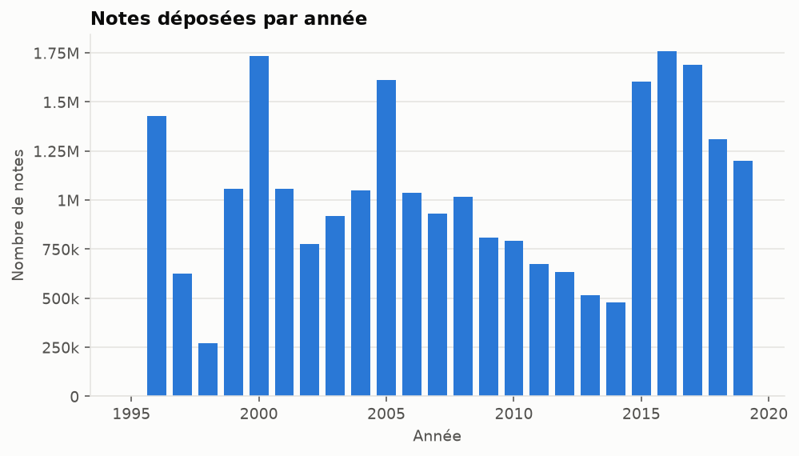

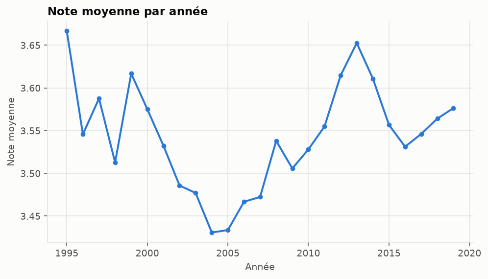

| year | n_ratings | mean_rating | active_users |
| --- | --- | --- | --- |
| 1995 | 3 | 3.667 | 1 |
| 1996 | 1,430,093 | 3.546 | 23,028 |
| 1997 | 626,202 | 3.588 | 10,014 |
| 1998 | 272,099 | 3.513 | 3,315 |
| 1999 | 1,059,080 | 3.617 | 8,387 |
| 2000 | 1,735,398 | 3.575 | 13,303 |
| 2001 | 1,058,750 | 3.532 | 9,300 |
| 2002 | 776,654 | 3.486 | 7,098 |
| 2003 | 920,295 | 3.477 | 7,674 |
| 2004 | 1,048,116 | 3.431 | 7,842 |
| 2005 | 1,613,550 | 3.434 | 11,187 |
| 2006 | 1,038,458 | 3.467 | 9,167 |
| 2007 | 931,432 | 3.472 | 8,472 |
| 2008 | 1,018,001 | 3.538 | 9,662 |
| 2009 | 810,127 | 3.506 | 8,793 |
| 2010 | 792,436 | 3.528 | 8,857 |
| 2011 | 676,498 | 3.555 | 8,402 |
| 2012 | 635,208 | 3.615 | 7,834 |
| 2013 | 515,684 | 3.653 | 7,196 |
| 2014 | 478,270 | 3.611 | 6,469 |
| 2015 | 1,604,971 | 3.557 | 14,262 |
| 2016 | 1,757,440 | 3.531 | 14,270 |
| 2017 | 1,689,935 | 3.546 | 13,252 |
| 2018 | 1,310,761 | 3.564 | 12,001 |
| 2019 | 1,200,634 | 3.576 | 10,601 |

### Tags

- Applications de tags : **1,093,333**
- Tags distincts (après normalisation) : **65,380**
- Utilisateurs ayant posé au moins un tag : **14,591**
- Films avec au moins un tag : **45,251** (**72.5%** du catalogue)

| tag | n_applications | n_movies |
| --- | --- | --- |
| sci-fi | 8,795 | 558 |
| atmospheric | 7,053 | 659 |
| action | 6,783 | 978 |
| comedy | 6,368 | 1,624 |
| surreal | 5,584 | 576 |
| funny | 5,354 | 1,165 |
| based on a book | 5,196 | 1,395 |
| twist ending | 4,904 | 297 |
| visually appealing | 4,691 | 346 |
| romance | 4,482 | 1,296 |
| dystopia | 4,329 | 370 |
| dark comedy | 4,133 | 474 |
| quirky | 3,999 | 478 |
| bd-r | 3,966 | 3,948 |
| thought-provoking | 3,847 | 220 |

## 9. Effet du nettoyage

| table | lignes brutes | lignes nettoyées | retirées |
| --- | --- | --- | --- |
| ratings | 25,000,095 | 25,000,095 | 0 |
| movies | 62,423 | 62,423 | 0 |
| tags | 1,093,360 | 1,093,333 | 27 |
| links | 62,423 | 62,423 | 0 |

### Jeu `interactions` destiné aux modèles

Filtrage itératif : au moins **20** notes par utilisateur et **20** notes par film.

| jeu | notes | utilisateurs | films |
| --- | --- | --- | --- |
| ratings nettoyé | 25,000,095 | 162,541 | 59,047 |
| interactions | 24,808,109 | 162,414 | 18,424 |

Le filtrage conserve **99.23%** des notes.
