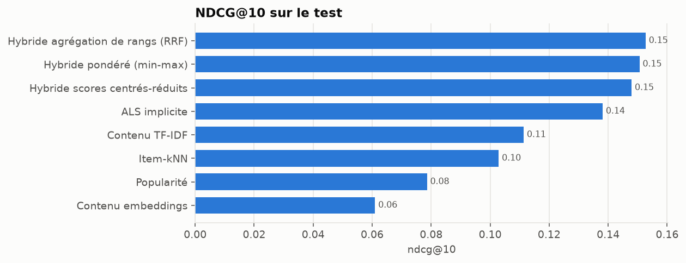
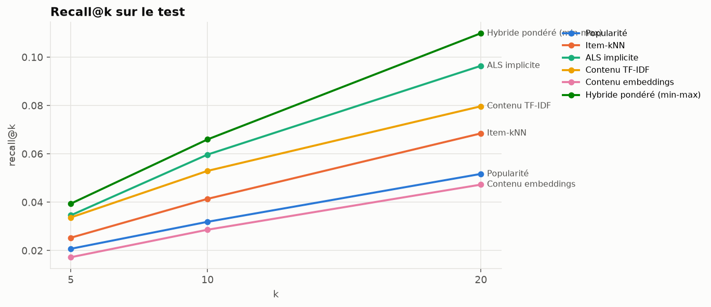
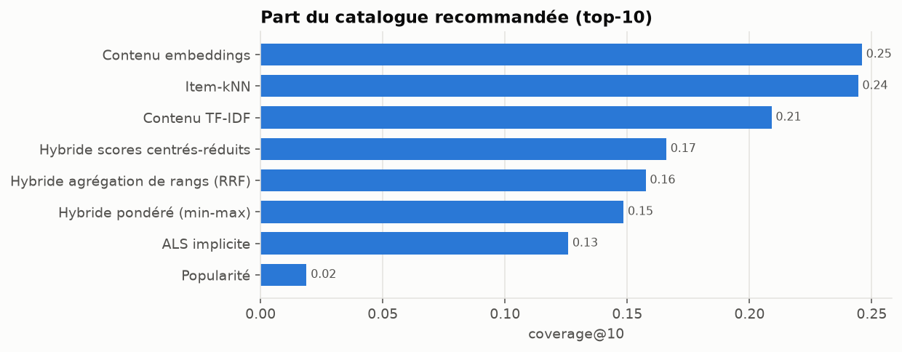
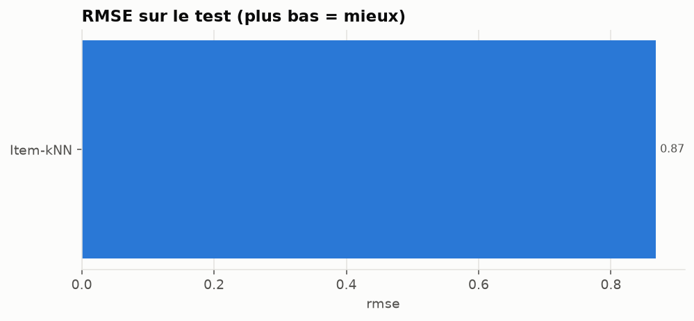
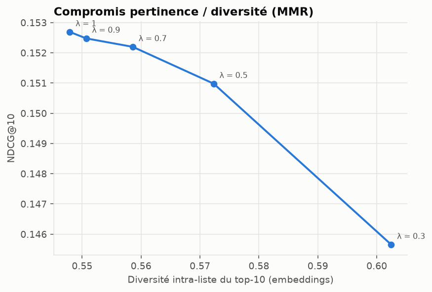
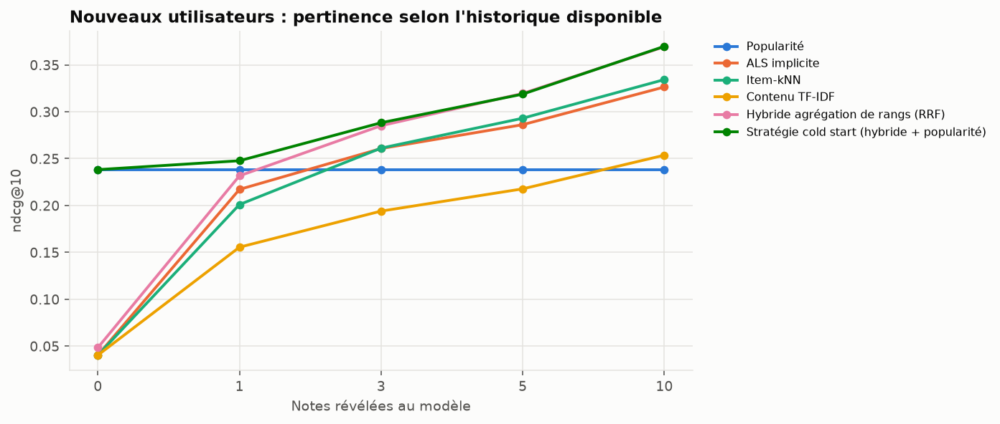

# Système hybride, diversité et cold start — résultats

> Fichier généré par `python scripts/build_model_report.py` à partir de
> `reports/hybrid_results.json`. Ne pas éditer à la main.

## Protocole

- Coupures temporelles globales aux quantiles 0.8 et 0.9 des notes classées par date.
- Film pertinent : note ≥ 4.0.
- Candidats : tous les films du catalogue d'entraînement non encore notés par l'utilisateur.
- Graine aléatoire : 42.

| jeu | train_end | train_ratings | train_users | train_items | holdout_ratings | holdout_users | holdout_cold_users | eval_users | eval_relevant |
| --- | --- | --- | --- | --- | --- | --- | --- | --- | --- |
| validation | 2016-06-25T06:49:57.600000+00:00 | 19,905,544 | 137,883 | 13,980 | 2,500,009 | 18,003 | 12,708 | 5,006 | 137,353 |
| test | 2018-01-04T02:45:00.800000+00:00 | 22,366,789 | 150,591 | 16,007 | 2,500,010 | 18,442 | 11,950 | 6,206 | 165,779 |

## Résultats sur le test

Modèles de référence repris de `reports/collaborative_results.json`, `reports/content_results.json` (même jeu de test).

### Top-5

| modèle | precision@5 | recall@5 | f1@5 | map@5 | ndcg@5 | coverage@5 |
| --- | --- | --- | --- | --- | --- | --- |
| Popularité | 0.0781 | 0.0207 | 0.0248 | 0.0545 | 0.0861 | 0.0131 |
| Item-kNN | 0.1033 | 0.0253 | 0.0319 | 0.0741 | 0.1118 | 0.1794 |
| ALS implicite | 0.1336 | 0.0345 | 0.0429 | 0.0953 | 0.1446 | 0.1010 |
| Contenu TF-IDF | 0.1074 | 0.0337 | 0.0387 | 0.0781 | 0.1215 | 0.1363 |
| Contenu embeddings | 0.0609 | 0.0172 | 0.0203 | 0.0373 | 0.0649 | 0.1709 |
| Hybride pondéré (min-max) | 0.1482 | 0.0394 | 0.0485 | 0.1082 | 0.1601 | 0.1084 |
| Hybride scores centrés-réduits | 0.1471 | 0.0394 | 0.0487 | 0.1072 | 0.1582 | 0.1231 |
| Hybride agrégation de rangs (RRF) | 0.1517 | 0.0400 | 0.0497 | 0.1108 | 0.1630 | 0.1181 |

### Top-10

| modèle | precision@10 | recall@10 | f1@10 | map@10 | ndcg@10 | coverage@10 |
| --- | --- | --- | --- | --- | --- | --- |
| Popularité | 0.0654 | 0.0319 | 0.0310 | 0.0406 | 0.0786 | 0.0188 |
| Item-kNN | 0.0881 | 0.0414 | 0.0423 | 0.0551 | 0.1029 | 0.2444 |
| ALS implicite | 0.1202 | 0.0597 | 0.0595 | 0.0747 | 0.1381 | 0.1258 |
| Contenu TF-IDF | 0.0890 | 0.0529 | 0.0482 | 0.0572 | 0.1113 | 0.2090 |
| Contenu embeddings | 0.0523 | 0.0286 | 0.0267 | 0.0272 | 0.0610 | 0.2460 |
| Hybride pondéré (min-max) | 0.1295 | 0.0659 | 0.0652 | 0.0841 | 0.1506 | 0.1484 |
| Hybride scores centrés-réduits | 0.1268 | 0.0658 | 0.0647 | 0.0825 | 0.1479 | 0.1659 |
| Hybride agrégation de rangs (RRF) | 0.1313 | 0.0674 | 0.0664 | 0.0855 | 0.1527 | 0.1575 |

### Top-20

| modèle | precision@20 | recall@20 | f1@20 | map@20 | ndcg@20 | coverage@20 |
| --- | --- | --- | --- | --- | --- | --- |
| Popularité | 0.0564 | 0.0517 | 0.0383 | 0.0326 | 0.0766 | 0.0272 |
| Item-kNN | 0.0738 | 0.0684 | 0.0519 | 0.0434 | 0.0992 | 0.3292 |
| ALS implicite | 0.1020 | 0.0964 | 0.0727 | 0.0610 | 0.1349 | 0.1531 |
| Contenu TF-IDF | 0.0723 | 0.0797 | 0.0547 | 0.0455 | 0.1068 | 0.3182 |
| Contenu embeddings | 0.0435 | 0.0472 | 0.0324 | 0.0212 | 0.0599 | 0.3525 |
| Hybride pondéré (min-max) | 0.1108 | 0.1099 | 0.0804 | 0.0692 | 0.1486 | 0.1975 |
| Hybride scores centrés-réduits | 0.1079 | 0.1091 | 0.0788 | 0.0678 | 0.1460 | 0.2205 |
| Hybride agrégation de rangs (RRF) | 0.1116 | 0.1131 | 0.0817 | 0.0702 | 0.1506 | 0.2148 |

### Prédiction de note

| modèle | rmse | mae |
| --- | --- | --- |
| Item-kNN | 0.8681 | 0.6324 |

### Coût et biais de popularité

| modèle | hyperparamètres retenus | entraînement (s) | ms / utilisateur | popularité moyenne du top-10 |
| --- | --- | --- | --- | --- |
| Popularité | relevance_threshold=4.0 | 0.2 | 0.3 | 49,957.1 |
| Item-kNN | k=50, shrinkage=100 | 92.3 | 1.7 | 12,068.0 |
| ALS implicite | factors=64, reg=0.01, alpha=10, iterations=15, relevance_threshold=4.0 | 111.6 | 0.8 | 20,408.4 |
| Contenu TF-IDF | genre_weight=0.2, tag_weight=1.0, title_weight=0.3, aggregation=knn, k=50 | 6.3 | 0.8 | 13,188.5 |
| Contenu embeddings | model=sentence-transformers/all-MiniLM-L6-v2, max_tags=15, aggregation=knn, k=50 | 4.9 | 0.6 | 6,227.9 |
| Hybride pondéré (min-max) | strategy=weighted, weights=als_implicit 0.50 + item_knn 0.25 + tfidf 0.25 | 0.0 | 1.3 | 19,925.8 |
| Hybride scores centrés-réduits | strategy=zscore, weights=als_implicit 0.50 + item_knn 0.25 + tfidf 0.25 | 0.0 | 1.6 | 18,203.4 |
| Hybride agrégation de rangs (RRF) | strategy=rrf, weights=als_implicit 0.50 + item_knn 0.25 + tfidf 0.25 | 0.0 | 4.0 | 19,276.6 |

## Analyse d'erreurs : NDCG@10 selon la taille de l'historique

| historique | utilisateurs | ALS implicite | Hybride agrégation de rangs (RRF) | Hybride pondéré (min-max) | Hybride scores centrés-réduits | Item-kNN | Popularité | Contenu TF-IDF |
| --- | --- | --- | --- | --- | --- | --- | --- | --- |
| 5-50 | 703 | 0.1657 | 0.1779 | 0.1753 | 0.1790 | 0.1451 | 0.1192 | 0.1205 |
| 51-150 | 1,295 | 0.1548 | 0.1611 | 0.1603 | 0.1574 | 0.1189 | 0.0880 | 0.1154 |
| 151-400 | 1,872 | 0.1357 | 0.1502 | 0.1447 | 0.1411 | 0.0978 | 0.0658 | 0.1125 |
| 401-1000 | 1,610 | 0.1204 | 0.1388 | 0.1383 | 0.1344 | 0.0826 | 0.0682 | 0.1065 |
| > 1000 | 726 | 0.1270 | 0.1505 | 0.1519 | 0.1486 | 0.0916 | 0.0786 | 0.1028 |

## Hybride retenu

- Stratégie : **Hybride agrégation de rangs (RRF)** (choisie sur la validation, NDCG@10 = 0.1699)
- Poids normalisés : ALS implicite 0.50, Item-kNN 0.25, Contenu TF-IDF 0.25

## Diversité et popularité (re-classement du meilleur hybride, test)

Descriptif : aucun réglage n'est sélectionné sur le test. `lambda = 1` et pénalité nulle
correspondent à l'hybride sans re-classement.

| lambda (MMR) | pénalité de popularité | NDCG@10 | Recall@10 | diversité (embeddings) | diversité (genres) | couverture@10 | popularité moyenne du top-10 |
| --- | --- | --- | --- | --- | --- | --- | --- |
| 1.0000 | 0.0000 | 0.1527 | 0.0674 | 0.5479 | 0.6257 | 0.1575 | 19,276.6391 |
| 0.9000 | 0.0000 | 0.1525 | 0.0671 | 0.5507 | 0.6284 | 0.1579 | 19,290.9901 |
| 0.7000 | 0.0000 | 0.1522 | 0.0672 | 0.5586 | 0.6363 | 0.1600 | 19,325.2900 |
| 0.5000 | 0.0000 | 0.1510 | 0.0664 | 0.5723 | 0.6479 | 0.1634 | 19,242.1404 |
| 0.3000 | 0.0000 | 0.1457 | 0.0638 | 0.6025 | 0.6709 | 0.1691 | 18,792.7815 |
| 1.0000 | 0.1000 | 0.1536 | 0.0684 | 0.5478 | 0.6249 | 0.1610 | 19,102.2822 |
| 1.0000 | 0.2000 | 0.1543 | 0.0694 | 0.5477 | 0.6237 | 0.1666 | 18,901.4962 |
| 1.0000 | 0.4000 | 0.1558 | 0.0716 | 0.5474 | 0.6207 | 0.1782 | 18,394.9943 |

## Cold start utilisateur

2,000 utilisateurs absents de l'entraînement, tirés au hasard. On révèle
leurs premières notes dans l'ordre chronologique ; la cible, identique pour toutes les
colonnes, est l'ensemble des films aimés après les 10 premières notes. NDCG@10 :

| modèle | 0 note | 1 note | 3 notes | 5 notes | 10 notes |
| --- | --- | --- | --- | --- | --- |
| Popularité | 0.2382 | 0.2382 | 0.2382 | 0.2382 | 0.2382 |
| ALS implicite | 0.0403 | 0.2171 | 0.2607 | 0.2862 | 0.3263 |
| Item-kNN | 0.0403 | 0.2010 | 0.2611 | 0.2930 | 0.3342 |
| Contenu TF-IDF | 0.0403 | 0.1555 | 0.1940 | 0.2177 | 0.2536 |
| Hybride agrégation de rangs (RRF) | 0.0483 | 0.2316 | 0.2851 | 0.3195 | 0.3692 |
| Stratégie cold start (hybride + popularité) | 0.2382 | 0.2477 | 0.2882 | 0.3187 | 0.3697 |

Recall@10 :

| modèle | 0 note | 1 note | 3 notes | 5 notes | 10 notes |
| --- | --- | --- | --- | --- | --- |
| Popularité | 0.0463 | 0.0463 | 0.0463 | 0.0463 | 0.0463 |
| ALS implicite | 0.0031 | 0.0429 | 0.0572 | 0.0648 | 0.0777 |
| Item-kNN | 0.0031 | 0.0376 | 0.0534 | 0.0605 | 0.0721 |
| Contenu TF-IDF | 0.0031 | 0.0281 | 0.0368 | 0.0439 | 0.0538 |
| Hybride agrégation de rangs (RRF) | 0.0039 | 0.0450 | 0.0613 | 0.0714 | 0.0848 |
| Stratégie cold start (hybride + popularité) | 0.0463 | 0.0483 | 0.0626 | 0.0712 | 0.0846 |

Choix du poids de la popularité, fait sur les nouveaux venus de la **validation** (prior retenu : **0.5**, NDCG@10) :

| prior | 0 note | 1 note | 3 notes | 5 notes | 10 notes | moyenne |
| --- | --- | --- | --- | --- | --- | --- |
| 0.25 | 0.2356 | 0.2342 | 0.2767 | 0.3071 | 0.3620 | 0.2831 |
| 0.5 | 0.2356 | 0.2367 | 0.2777 | 0.3069 | 0.3606 | 0.2835 |
| 1 | 0.2356 | 0.2392 | 0.2777 | 0.3057 | 0.3590 | 0.2834 |
| 3 | 0.2356 | 0.2382 | 0.2681 | 0.2933 | 0.3438 | 0.2758 |

## Cold start film

Films absents du catalogue d'entraînement (moins de 20 notes avant la coupure, films
sortis ensuite compris), classés par leur seul contenu pour les utilisateurs évalués
qui en ont aimé au moins un.

| modèle | recall@10 | ndcg@10 | recall@20 |
| --- | --- | --- | --- |
| Contenu TF-IDF | 0.0312 | 0.0378 | 0.0355 |
| Hasard | 0.0003 | 0.0005 | 0.0008 |
| Contenu embeddings | 0.0213 | 0.0244 | 0.0301 |

- Contenu TF-IDF : 3,837 utilisateurs, 26,470 films candidats
- Contenu embeddings : 3,837 utilisateurs, 26,470 films candidats

## Sélection des hyperparamètres (validation)

| modèle | params | ndcg@10 | recall@10 | coverage@10 | fit_seconds |
| --- | --- | --- | --- | --- | --- |
| Hybride pondéré (min-max) | strategy=weighted, weights=als_implicit 0.25 + item_knn 0.25 + tfidf 0.25 + embeddings 0.25 | 0.1433 | 0.0626 | 0.1820 | 0.0000 |
| Hybride pondéré (min-max) | strategy=weighted, weights=als_implicit 0.50 + tfidf 0.50 | 0.1533 | 0.0681 | 0.1526 | 0.0000 |
| Hybride pondéré (min-max) | strategy=weighted, weights=als_implicit 0.67 + tfidf 0.33 | 0.1647 | 0.0749 | 0.1310 | 0.0000 |
| Hybride pondéré (min-max) | strategy=weighted, weights=als_implicit 0.33 + item_knn 0.33 + tfidf 0.33 | 0.1602 | 0.0726 | 0.1759 | 0.0000 |
| Hybride pondéré (min-max) | strategy=weighted, weights=als_implicit 0.50 + item_knn 0.25 + tfidf 0.25 | 0.1696 | 0.0773 | 0.1502 | 0.0000 |
| Hybride pondéré (min-max) | strategy=weighted, weights=als_implicit 0.40 + item_knn 0.20 + tfidf 0.40 | 0.1592 | 0.0720 | 0.1642 | 0.0000 |
| Hybride pondéré (min-max) | strategy=weighted, weights=als_implicit 0.43 + item_knn 0.14 + tfidf 0.29 + embeddings 0.14 | 0.1607 | 0.0720 | 0.1528 | 0.0000 |
| Hybride scores centrés-réduits | strategy=zscore, weights=als_implicit 0.25 + item_knn 0.25 + tfidf 0.25 + embeddings 0.25 | 0.1502 | 0.0679 | 0.1906 | 0.0000 |
| Hybride scores centrés-réduits | strategy=zscore, weights=als_implicit 0.50 + tfidf 0.50 | 0.1491 | 0.0670 | 0.1519 | 0.0000 |
| Hybride scores centrés-réduits | strategy=zscore, weights=als_implicit 0.67 + tfidf 0.33 | 0.1621 | 0.0736 | 0.1312 | 0.0000 |
| Hybride scores centrés-réduits | strategy=zscore, weights=als_implicit 0.33 + item_knn 0.33 + tfidf 0.33 | 0.1564 | 0.0720 | 0.1915 | 0.0000 |
| Hybride scores centrés-réduits | strategy=zscore, weights=als_implicit 0.50 + item_knn 0.25 + tfidf 0.25 | 0.1669 | 0.0777 | 0.1670 | 0.0000 |
| Hybride scores centrés-réduits | strategy=zscore, weights=als_implicit 0.40 + item_knn 0.20 + tfidf 0.40 | 0.1571 | 0.0717 | 0.1740 | 0.0000 |
| Hybride scores centrés-réduits | strategy=zscore, weights=als_implicit 0.43 + item_knn 0.14 + tfidf 0.29 + embeddings 0.14 | 0.1620 | 0.0742 | 0.1629 | 0.0000 |
| Hybride agrégation de rangs (RRF) | strategy=rrf, weights=als_implicit 0.25 + item_knn 0.25 + tfidf 0.25 + embeddings 0.25 | 0.1490 | 0.0671 | 0.1923 | 0.0000 |
| Hybride agrégation de rangs (RRF) | strategy=rrf, weights=als_implicit 0.50 + tfidf 0.50 | 0.1554 | 0.0687 | 0.1591 | 0.0000 |
| Hybride agrégation de rangs (RRF) | strategy=rrf, weights=als_implicit 0.67 + tfidf 0.33 | 0.1628 | 0.0738 | 0.1456 | 0.0000 |
| Hybride agrégation de rangs (RRF) | strategy=rrf, weights=als_implicit 0.33 + item_knn 0.33 + tfidf 0.33 | 0.1632 | 0.0758 | 0.1923 | 0.0000 |
| Hybride agrégation de rangs (RRF) | strategy=rrf, weights=als_implicit 0.50 + item_knn 0.25 + tfidf 0.25 | 0.1699 | 0.0772 | 0.1612 | 0.0000 |
| Hybride agrégation de rangs (RRF) | strategy=rrf, weights=als_implicit 0.40 + item_knn 0.20 + tfidf 0.40 | 0.1640 | 0.0741 | 0.1729 | 0.0000 |
| Hybride agrégation de rangs (RRF) | strategy=rrf, weights=als_implicit 0.43 + item_knn 0.14 + tfidf 0.29 + embeddings 0.14 | 0.1639 | 0.0742 | 0.1620 | 0.0000 |
