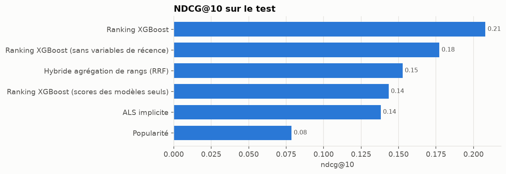
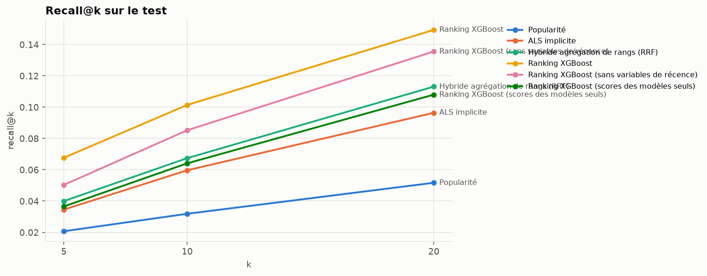
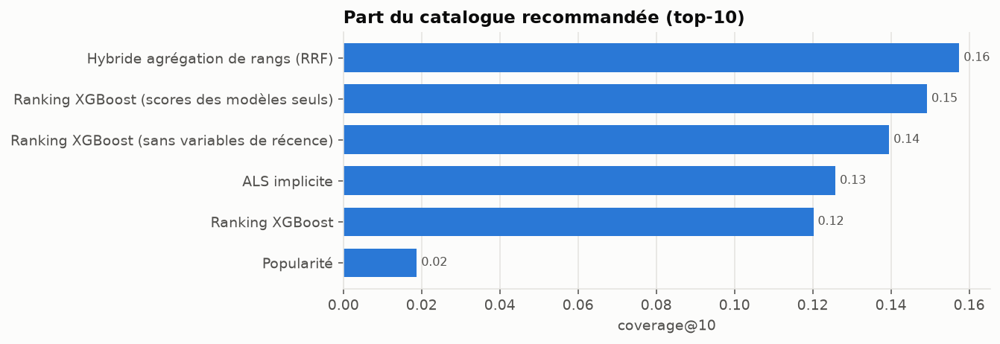
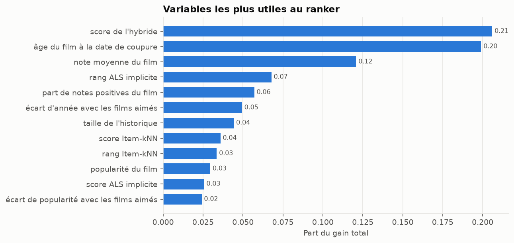

# Learning to rank (XGBoost) — résultats

> Fichier généré par `python scripts/build_model_report.py` à partir de
> `reports/ranking_results.json`. Ne pas éditer à la main.

## Protocole

- Coupures temporelles globales aux quantiles 0.8 et 0.9 des notes classées par date.
- Film pertinent : note ≥ 4.0.
- Candidats : tous les films du catalogue d'entraînement non encore notés par l'utilisateur.
- Graine aléatoire : 42.

| jeu | train_end | train_ratings | train_users | train_items | holdout_ratings | holdout_users | holdout_cold_users | eval_users | eval_relevant |
| --- | --- | --- | --- | --- | --- | --- | --- | --- | --- |
| validation | 2016-06-25T06:49:57.600000+00:00 | 19,905,544 | 137,883 | 13,980 | 2,500,009 | 18,003 | 12,708 | 5,006 | 137,353 |
| test | 2018-01-04T02:45:00.800000+00:00 | 22,366,789 | 150,591 | 16,007 | 2,500,010 | 18,442 | 11,950 | 6,206 | 165,779 |

## Résultats sur le test

Modèles de référence repris de `reports/collaborative_results.json`, `reports/hybrid_results.json` (même jeu de test).

### Top-5

| modèle | precision@5 | recall@5 | f1@5 | map@5 | ndcg@5 | coverage@5 |
| --- | --- | --- | --- | --- | --- | --- |
| Popularité | 0.0781 | 0.0207 | 0.0248 | 0.0545 | 0.0861 | 0.0131 |
| ALS implicite | 0.1336 | 0.0345 | 0.0429 | 0.0953 | 0.1446 | 0.1010 |
| Hybride agrégation de rangs (RRF) | 0.1517 | 0.0400 | 0.0497 | 0.1108 | 0.1630 | 0.1181 |
| Ranking XGBoost | 0.2022 | 0.0677 | 0.0774 | 0.1583 | 0.2270 | 0.0850 |
| Ranking XGBoost (sans variables de récence) | 0.1732 | 0.0503 | 0.0605 | 0.1289 | 0.1878 | 0.1065 |
| Ranking XGBoost (scores des modèles seuls) | 0.1393 | 0.0366 | 0.0447 | 0.0986 | 0.1484 | 0.1180 |

### Top-10

| modèle | precision@10 | recall@10 | f1@10 | map@10 | ndcg@10 | coverage@10 |
| --- | --- | --- | --- | --- | --- | --- |
| Popularité | 0.0654 | 0.0319 | 0.0310 | 0.0406 | 0.0786 | 0.0188 |
| ALS implicite | 0.1202 | 0.0597 | 0.0595 | 0.0747 | 0.1381 | 0.1258 |
| Hybride agrégation de rangs (RRF) | 0.1313 | 0.0674 | 0.0664 | 0.0855 | 0.1527 | 0.1575 |
| Ranking XGBoost | 0.1661 | 0.1014 | 0.0926 | 0.1221 | 0.2079 | 0.1202 |
| Ranking XGBoost (sans variables de récence) | 0.1493 | 0.0852 | 0.0800 | 0.1007 | 0.1772 | 0.1396 |
| Ranking XGBoost (scores des modèles seuls) | 0.1261 | 0.0641 | 0.0630 | 0.0784 | 0.1434 | 0.1492 |

### Top-20

| modèle | precision@20 | recall@20 | f1@20 | map@20 | ndcg@20 | coverage@20 |
| --- | --- | --- | --- | --- | --- | --- |
| Popularité | 0.0564 | 0.0517 | 0.0383 | 0.0326 | 0.0766 | 0.0272 |
| ALS implicite | 0.1020 | 0.0964 | 0.0727 | 0.0610 | 0.1349 | 0.1531 |
| Hybride agrégation de rangs (RRF) | 0.1116 | 0.1131 | 0.0817 | 0.0702 | 0.1506 | 0.2148 |
| Ranking XGBoost | 0.1327 | 0.1494 | 0.1020 | 0.1006 | 0.1992 | 0.1661 |
| Ranking XGBoost (sans variables de récence) | 0.1233 | 0.1356 | 0.0935 | 0.0830 | 0.1734 | 0.1850 |
| Ranking XGBoost (scores des modèles seuls) | 0.1093 | 0.1080 | 0.0791 | 0.0655 | 0.1434 | 0.1860 |

### Coût et biais de popularité

| modèle | hyperparamètres retenus | entraînement (s) | ms / utilisateur | popularité moyenne du top-10 |
| --- | --- | --- | --- | --- |
| Popularité | relevance_threshold=4.0 | 0.2 | 0.3 | 49,957.1 |
| ALS implicite | factors=64, reg=0.01, alpha=10, iterations=15, relevance_threshold=4.0 | 111.6 | 0.8 | 20,408.4 |
| Hybride agrégation de rangs (RRF) | strategy=rrf, weights=als_implicit 0.50 + item_knn 0.25 + tfidf 0.25 | 0.0 | 4.0 | 19,276.6 |
| Ranking XGBoost | max_depth=6, learning_rate=0.05, n_estimators=141, subsample=0.8, colsample_bytree=0.8, best_iteration=None, n_candidates=100, n_features=19 | 31.2 | 21.4 | 17,123.8 |
| Ranking XGBoost (sans variables de récence) | max_depth=6, learning_rate=0.05, n_estimators=141, subsample=0.8, colsample_bytree=0.8, best_iteration=None, n_candidates=100, n_features=17 | 34.7 | 21.0 | 18,566.5 |
| Ranking XGBoost (scores des modèles seuls) | max_depth=6, learning_rate=0.05, n_estimators=141, subsample=0.8, colsample_bytree=0.8, best_iteration=None, n_candidates=100, n_features=9 | 18.8 | 19.7 | 17,392.0 |

## Analyse d'erreurs : NDCG@10 selon la taille de l'historique

| historique | utilisateurs | ALS implicite | Hybride agrégation de rangs (RRF) | Popularité | Ranking XGBoost | Ranking XGBoost (sans variables de récence) | Ranking XGBoost (scores des modèles seuls) |
| --- | --- | --- | --- | --- | --- | --- | --- |
| 5-50 | 703 | 0.1657 | 0.1779 | 0.1192 | 0.2012 | 0.1886 | 0.1783 |
| 51-150 | 1,295 | 0.1548 | 0.1611 | 0.0880 | 0.1937 | 0.1801 | 0.1484 |
| 151-400 | 1,872 | 0.1357 | 0.1502 | 0.0658 | 0.2008 | 0.1721 | 0.1361 |
| 401-1000 | 1,610 | 0.1204 | 0.1388 | 0.0682 | 0.2158 | 0.1723 | 0.1314 |
| > 1000 | 726 | 0.1270 | 0.1505 | 0.0786 | 0.2409 | 0.1849 | 0.1463 |

## Jeu d'entraînement du ranker

- 5,006 utilisateurs (1,001 gardés pour le réglage), 100 candidats chacun, 19 variables.
- Variables calculées avec les modèles entraînés jusqu'à la première coupure ; labels pris dans la période de validation.
- Plafond du rappel : 32.2% des films aimés figurent parmi les candidats (jeu de réglage). Le ranker ne peut pas faire remonter un film absent.
- 581 utilisateurs d'entraînement n'ont aucun film aimé parmi leurs candidats.

| label | lignes | part |
| --- | --- | --- |
| 2 — aimé (note ≥ seuil) | 27,659 | 6.91% |
| 1 — non noté (inconnu) | 357,005 | 89.14% |
| 0 — noté sous le seuil (rejet) | 15,836 | 3.95% |

## Réglage sur le jeu de dev

- Référence, ordre de l'hybride sans ranker : NDCG@10 = 0.1803
- Meilleure configuration : `{'labels': 'binary', 'max_depth': 6, 'learning_rate': 0.05, 'best_iteration': 140}`, NDCG@10 = 0.2281

## Importance des variables

| variable | nom technique | part du gain |
| --- | --- | --- |
| score de l'hybride | score_hybrid | 0.2060 |
| âge du film à la date de coupure | item_age | 0.1991 |
| note moyenne du film | item_mean_rating | 0.1208 |
| rang ALS implicite | log_rank_als_implicit | 0.0678 |
| part de notes positives du film | item_liked_share | 0.0571 |
| écart d'année avec les films aimés | year_gap | 0.0494 |
| taille de l'historique | user_log_history | 0.0443 |
| score Item-kNN | score_item_knn | 0.0359 |
| rang Item-kNN | log_rank_item_knn | 0.0336 |
| popularité du film | item_log_popularity | 0.0295 |
| score ALS implicite | score_als_implicit | 0.0257 |
| écart de popularité avec les films aimés | popularity_gap | 0.0242 |
| score Contenu TF-IDF | score_tfidf | 0.0200 |
| rang Contenu TF-IDF | log_rank_tfidf | 0.0192 |
| score Contenu embeddings | score_embeddings | 0.0160 |
| affinité de genres | genre_affinity | 0.0160 |
| rang Contenu embeddings | log_rank_embeddings | 0.0142 |
| note moyenne de l'utilisateur | user_mean_rating | 0.0116 |
| part de films aimés par l'utilisateur | user_liked_share | 0.0098 |

## Sélection des hyperparamètres (validation)

| modèle | params | ndcg@10 | recall@10 | coverage@10 | fit_seconds |
| --- | --- | --- | --- | --- | --- |
| Ranking XGBoost | labels=graded, max_depth=4, learning_rate=0.05, best_iteration=172 | 0.2248 | 0.1044 | 0.0753 | 31.8111 |
| Ranking XGBoost | labels=graded, max_depth=6, learning_rate=0.05, best_iteration=251 | 0.2265 | 0.1038 | 0.0786 | 72.3000 |
| Ranking XGBoost | labels=graded, max_depth=6, learning_rate=0.1, best_iteration=132 | 0.2262 | 0.1032 | 0.0784 | 51.4837 |
| Ranking XGBoost | labels=binary, max_depth=4, learning_rate=0.05, best_iteration=128 | 0.2250 | 0.1047 | 0.0738 | 26.8944 |
| Ranking XGBoost | labels=binary, max_depth=6, learning_rate=0.05, best_iteration=140 | 0.2281 | 0.1050 | 0.0751 | 33.8419 |
| Ranking XGBoost | labels=binary, max_depth=6, learning_rate=0.1, best_iteration=139 | 0.2272 | 0.1053 | 0.0773 | 33.8248 |
